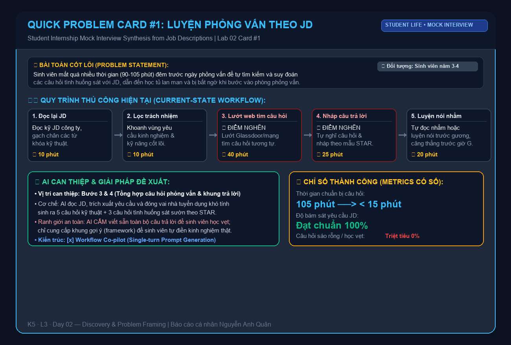
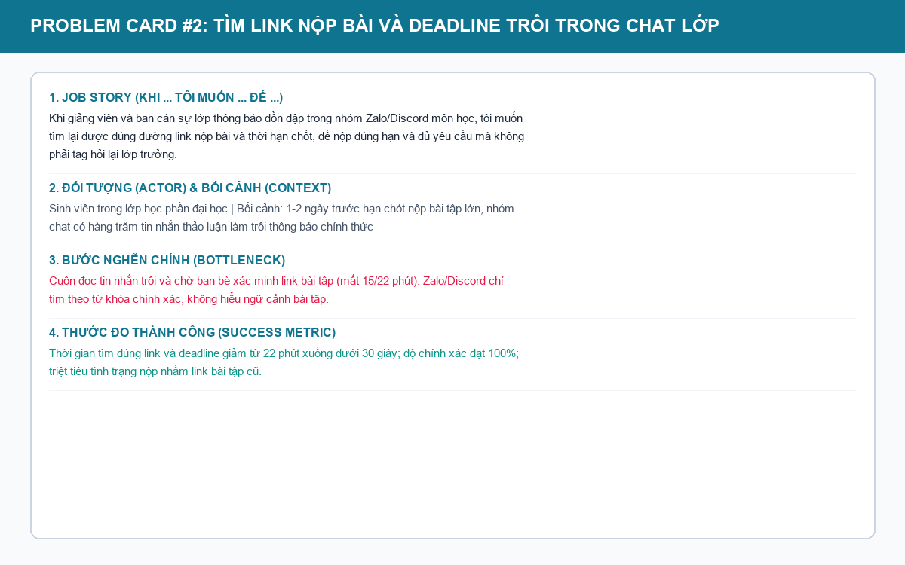
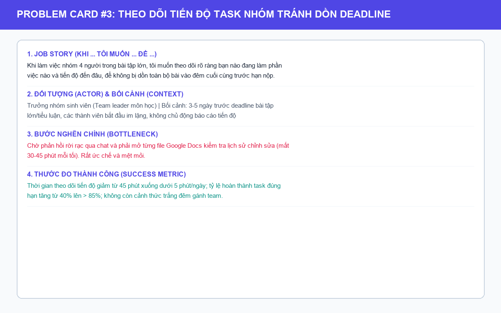

# Báo cáo cá nhân — 2A202603892_NguyenAnhQuan

> Đổi tên file theo quy tắc `MSSV_HoTen.md`, ví dụ `20241234_NguyenVanAn.md` (MSSV trước, dấu `_`, họ tên viết liền không dấu). Sửa cả dòng tiêu đề phía trên cho khớp.  
> Template chi tiết và prompt mẫu cho từng mục: [docs/01-worksheet.md](../../docs/01-worksheet.md).  
> Mỗi thành viên một file trong `report/individual/` trên repo nhóm: copy template này thành file mới, điền, rồi commit bằng tài khoản GitHub của bạn. Không viết hộ người khác.

## 1. Thông tin học viên

- Họ tên: Nguyễn Anh Quân
- MSSV: 2A202603892
- Email trường: quanna.2a202603892@sis.hanu.edu.vn
- Tên nhóm: NhomQuan
- Link repo nhóm: https://github.com/AnhQuanHANU/K5-L3-Day02-NguyenAnhQuan03892-DiscoveryProblemFraming

---

## 2. Scan problem (CP1)

Lăng kính: **Lặp lại** · **Tốn thời gian** · **Cần đọc, tổng hợp nhiều thông tin** · **Pain từ người khác**.

*(Thực hiện quét 10 bài toán thực tế gắn liền với cuộc sống sinh viên đại học, đi tìm việc thực tập và sinh hoạt tại căn hộ thuê chung. Đạt tiêu chuẩn Bonus B1, toàn bộ viết theo chuẩn Job Story, không chứa từ khóa giải pháp, có số liệu đo lường thực tế).*

| # | Lăng kính | Job Story: Khi… tôi muốn… để… | Ai chịu ảnh hưởng? | Dấu hiệu thật (thời gian, tần suất, số người, bằng chứng) |
|---:|---|---|---|---|
| 1 | Tốn thời gian | Khi chuẩn bị nộp CV ứng tuyển vị trí thực tập cụ thể, tôi muốn điều chỉnh các gạch đầu dòng mô tả dự án học tập cho khớp với từ khóa trong bản mô tả công việc (JD), để hồ sơ không bị loại ngay từ vòng lọc tự động (ATS) | Sinh viên năm cuối, người tìm việc thực tập | Bấm giờ thực tế: 45–60 phút cho mỗi lần chỉnh sửa CV; nộp 12–15 công ty/tháng; tỷ lệ nhận phản hồi chỉ khoảng 10-15% nếu dùng CV chung |
| 2 | Cần đọc, tổng hợp nhiều thông tin | Khi đọc một bản tin tuyển dụng (JD) dài 2–3 trang trên LinkedIn/TopCV, tôi muốn bóc tách nhanh các kỹ năng bắt buộc (must-have) so với kỹ năng ưu tiên (nice-to-have), để đánh giá độ phù hợp của bản thân trước khi nộp | Sinh viên tìm việc | Đọc và gạch chân mất 20–30 phút/JD; trung bình đọc 15–20 JD mỗi tuần trong đợt cao điểm tìm thực tập |
| 3 | Tốn thời gian | Khi nhận được lời mời phỏng vấn kỹ thuật/tình huống vào ngày mai, tôi muốn tổng hợp các câu hỏi phỏng vấn thường gặp dựa trên chính các yêu cầu trong JD, để luyện tập câu trả lời có trọng tâm mà không bị bỡ ngỡ | Sinh viên chuẩn bị phỏng vấn | Mất 90 phút lướt các diễn đàn/Glassdoor tìm câu hỏi tương tự; 2–3 buổi phỏng vấn/tháng |
| 4 | Lặp lại | Khi chuẩn bị nộp bài tập lớn/lab trước deadline 23h59, tôi muốn đối chiếu toàn bộ các quy định đặt tên file, cấu trúc thư mục và tiêu chí rubric, để không bị trừ 5–10 điểm vì lỗi format ngớ ngẩn | Sinh viên, Nhóm trưởng môn học | Mất 35–45 phút mở tài liệu rubric 10 trang dò từng dòng checklist; tuần nào cũng có 1–2 bài lab nộp dồn dập |
| 5 | Cần đọc, tổng hợp nhiều thông tin | Khi làm tiểu luận hoặc đề tài môn học cần đọc các bài báo nghiên cứu tiếng Anh dài 30–50 trang, tôi muốn nắm nhanh phương pháp nghiên cứu và phát hiện chính, để trích dẫn vào bài mà không mất cả ngày dịch hiểu từng đoạn | Sinh viên làm tiểu luận/nghiên cứu | 2–3 tiếng cho một bài báo khoa học; mỗi kỳ phải đọc tham khảo từ 5–7 bài; gây chậm tiến độ viết đề cương |
| 6 | Pain từ người khác | Khi giảng viên và ban cán sự lớp thông báo dồn dập trong nhóm Zalo/Discord môn học, tôi muốn tìm lại được đúng đường link nộp bài và thời hạn chốt, để không bị nộp muộn do trôi tin nhắn | Sinh viên trong lớp | Mất 15–20 phút cuộn tìm tin nhắn cũ giữa hàng trăm tin chat thảo luận; 3/8 tuần gần nhất có bạn nộp muộn vì không thấy link nộp |
| 7 | Pain từ người khác | Khi làm việc nhóm 4 người trong bài tập lớn, tôi muốn theo dõi rõ ràng bạn nào đang làm phần việc nào và tiến độ đến đâu, để không bị dồn toàn bộ bài vào đêm cuối cùng trước hạn nộp | Trưởng nhóm, Thành viên nhóm | Nhóm trưởng mất 45 phút mỗi tối nhắn tin giục bài từng người; 80% bài tập nhóm bị tình trạng "nước đến chân mới nhảy" vào 2 ngày cuối |
| 8 | Lặp lại | Khi nhận hóa đơn tổng tiền điện, nước và phí quản lý căn hộ chung cư vào ngày 5 hàng tháng, tôi muốn chia đều chi phí chính xác theo số ngày có mặt thực tế của từng bạn cùng phòng, để thu tiền sòng phẳng không gây xích mích | Sinh viên ở ghép căn hộ/phòng trọ | Mất 30 phút nhập bảng tính Excel, tính bù trừ ngày về quê và chụp ảnh gửi nhóm phòng; diễn ra đều đặn 1 lần/tháng với 3 bạn cùng phòng |
| 9 | Pain từ người khác | Khi đồ đạc trong căn hộ thuê bị hỏng hóc (máy lạnh chảy nước, bình nóng lạnh không nóng), tôi muốn mô tả chính xác triệu chứng lỗi và vị trí kèm ảnh, để chủ nhà cử đúng thợ sửa chữa trong ngày mà không phải nhắn tin hỏi đi hỏi lại | Sinh viên thuê trọ, Chủ nhà | Mất 20 phút nhắn tin giải thích qua lại; 2 lần gần nhất thợ đến nhầm đồ nghề phải hẹn lại sang ngày hôm sau |
| 10 | Lặp lại | Khi cuối tháng tài khoản ngân hàng báo sắp hết tiền, tôi muốn tổng hợp các khoản tiền ăn uống, mua sắm lắt nhắt từ nhiều tài khoản (Vietcombank, MoMo, tiền mặt), để biết mình đã chi lố vào việc gì và cân đối tháng sau | Sinh viên tự lập tài chính | Mất 45 phút ngồi cộng sổ/app; tháng nào cũng bị hụt từ 500k–1 triệu đồng mà không rõ đã tiêu vào khoản gì |

**Nếu có dùng AI để gợi ý thêm:**  
Sau khi tự mình liệt kê 8 vấn đề từ chính cuộc sống hằng ngày của bản thân và bạn cùng phòng, tôi dùng AI để brainstorm thêm 2 bài toán về quản lý sinh hoạt:
- **Ý giữ lại:** Ý #9 (Báo lỗi đồ đạc phòng trọ) và Ý #10 (Tổng hợp chi tiêu sinh viên cuối tháng) vì có bối cảnh thực tế rõ ràng, lặp lại hàng tháng.
- **Ý loại bỏ:** AI gợi ý *"Xây dựng hệ thống AI tự động nộp hồ sơ xin việc hàng loạt (Auto-apply) lên 100 công ty cùng lúc"*. Tôi loại bỏ vì hành vi này là spam hồ sơ, chất lượng CV kém và chắc chắn sẽ bị các nhà tuyển dụng đưa vào danh sách đen (blacklist).

---

## 3. Top 3 Problem Cards + quy trình nháp (CP2)

### Bảng chọn top 3

| Rank | Problem | Vì sao chọn | Điều còn chưa chắc |
|---:|---|---|---|
| 1 | Tổng hợp câu hỏi phỏng vấn tình huống bám sát JD thực tập (#3) | Nhu cầu cực kỳ cấp thiết của sinh viên năm 3–4, thời gian chuẩn bị thủ công rất lâu (90–105 phút), bottleneck rõ ở bước tìm kiếm câu hỏi tình huống phù hợp với tech-stack/yêu cầu của công ty | Liệu sinh viên có bị tâm lý học tủ các câu trả lời máy móc mà thiếu đi sự tự nhiên trong phỏng vấn? |
| 2 | Tìm link nộp bài và thông báo deadline bị trôi trong Zalo/Discord lớp (#6) | Nỗi đau kinh niên của sinh viên mọi khóa học, tin nhắn chat thông thường làm trôi mất thông báo quan trọng của giảng viên, dẫn đến trễ hạn nộp bài | Các nhóm chat thường dùng tiếng lóng (slang), viết tắt hoặc gửi ảnh chụp màn hình, AI có trích xuất chính xác 100% không? |
| 3 | Theo dõi tiến độ task làm việc nhóm tránh dồn deadline phút chót (#7) | Bài toán làm việc nhóm gây ức chế nhất thời sinh viên ("nạn gánh team"), quy trình lộn xộn, tổn thất thời gian và rạn nứt tình cảm bạn bè | Bản chất là vấn đề ý thức và kỷ luật cá nhân, liệu công cụ công nghệ có thay đổi được hành vi trì hoãn? |

---

### Problem Card #1 — Tổng hợp câu hỏi phỏng vấn tình huống bám sát JD thực tập (Card chọn để Pitch)

| Trường | Nội dung |
|---|---|
| Job Story | Khi nhận được lời mời phỏng vấn kỹ thuật/tình huống vào ngày mai, tôi muốn tổng hợp các câu hỏi phỏng vấn thường gặp dựa trên chính các yêu cầu trong JD, để luyện tập câu trả lời có trọng tâm mà không bị bỡ ngỡ |
| Actor | Sinh viên năm 3 / năm 4 đang chuẩn bị cho các vòng phỏng vấn thực tập hoặc việc làm đầu tiên |
| Thời điểm / bối cảnh | Đêm trước ngày phỏng vấn (khoảng 20h–23h), sinh viên vừa nhận được email mời phỏng vấn và đang rất hồi hộp, căng thẳng |
| Quy trình hiện tại (3–7 bước) | 1. Mở lại bản mô tả công việc (JD) của công ty và đọc lại toàn bộ · 2. Gạch chân các kỹ năng kỹ thuật và trách nhiệm công việc cốt lõi · 3. Lướt Glassdoor, Reddit, các hội nhóm Facebook tìm xem công ty này hay hỏi gì · 4. Vắt óc tự nghĩ các câu hỏi tình huống phỏng vấn và nháp câu trả lời theo cấu trúc STAR · 5. Tự đọc nhẩm hoặc luyện nói trước gương |
| Bottleneck (bước nào, mất bao nhiêu phút) | **Bước 3 & 4 (mất 65 trên tổng số 105 phút):** Tìm kiếm thông tin rời rạc trên mạng thường nhận được các câu hỏi quá chung chung hoặc lỗi thời; việc tự nghĩ ra câu hỏi tình huống sát với JD mất rất nhiều thời gian |
| Impact (nếu không giải thì sao) | Mất 90–120 phút chuẩn bị cho mỗi cuộc phỏng vấn; học tủ lan man câu hỏi không đúng trọng tâm; vào phòng phỏng vấn bị "khớp" và trượt cơ hội thực tập quý giá |
| Success metric (baseline → target) | Thời gian chuẩn bị bộ câu hỏi rút ngắn từ **105 phút xuống dưới 15 phút**; **100% câu hỏi bám sát** đúng tech-stack và tình huống thực tế của JD; sinh viên tự tin hơn |
| Phương án không dùng AI | Một danh sách 50 câu hỏi phỏng vấn mẫu (General Question Bank) in sẵn: Sinh viên tự lọc câu nào liên quan để học |
| Giả thuyết về AI (nếu có) | AI Co-pilot đọc JD, đối chiếu với hồ sơ sinh viên, đóng vai người phỏng vấn khó tính sinh ra 5 câu hỏi kỹ thuật chuyên sâu và 3 câu hỏi tình huống ứng xử (Behavioral) sát sườn, kèm gợi ý các ý chính cần trả lời |
| Cảm nhận nhanh | **Workflow** (Quy trình cố định, AI đóng vai trò mô phỏng và gợi ý câu hỏi, sinh viên tự mình chuẩn bị nội dung câu trả lời thật) |

Quy trình nháp hiện tại:



```text
HIỆN TẠI — 105 phút chuẩn bị phỏng vấn

[1. Đọc lại JD: 10'] → [2. Gạch chân yêu cầu: 10'] 
→ [3. Lướt Glassdoor/mạng tìm câu hỏi: 40'] 🔴 BOTTLENECK
→ [4. Tự nghĩ câu hỏi & nháp câu trả lời STAR: 25'] 🔴 BOTTLENECK
→ [5. Luyện nói trước gương: 20']
Tổng thời gian: 105 phút căng thẳng trong đêm trước ngày phỏng vấn. (🔴 = Bước nghẽn mất 65 phút)
```

---

### Problem Card #2 — Tìm link nộp bài và thông báo deadline bị trôi trong Zalo/Discord lớp

| Trường | Nội dung |
|---|---|
| Job Story | Khi giảng viên và ban cán sự lớp thông báo dồn dập trong nhóm Zalo/Discord môn học, tôi muốn tìm lại được đúng đường link nộp bài và thời hạn chốt, để không bị nộp muộn do trôi tin nhắn |
| Actor | Sinh viên trong lớp học phần đại học |
| Thời điểm / bối cảnh | 1–2 ngày trước hạn chót nộp bài tập, nhóm chat lớp đang có hàng trăm tin nhắn thảo luận bài học, đùa giỡn, hỏi bài làm trôi mất thông báo chính thức |
| Quy trình hiện tại (3–7 bước) | 1. Mở ứng dụng Zalo / Discord của lớp học phần · 2. Gõ từ khóa tìm kiếm trong ô search (ví dụ: 'link', 'nộp bài', 'deadline') · 3. Cuộn ngược đọc hàng chục tin nhắn xung quanh để xác nhận link này là của bài tập nào và hạn chốt là khi nào · 4. Nhắn tin hỏi riêng bạn bè hoặc ban cán sự để xác minh lại cho chắc ăn · 5. Lưu lại link vào bookmark hoặc ghi chú điện thoại |
| Bottleneck (bước nào, mất bao nhiêu phút) | **Bước 3 & 4 (mất 15 trên tổng số 22 phút):** Tìm kiếm của Zalo chỉ lọc theo từ khóa chính xác, không hiểu ngữ cảnh; việc đọc tin nhắn trôi và chờ bạn bè trả lời xác nhận rất mất thời gian |
| Impact (nếu không giải thì sao) | Mất tập trung; trung bình có 2–3 sinh viên mỗi kỳ bị nộp nhầm link bài tập cũ hoặc nộp muộn giờ bị trừ điểm chuyên cần / điểm 0; ban cán sự lớp mệt mỏi vì bị hỏi đi hỏi lại cùng 1 câu hỏi |
| Success metric (baseline → target) | Thời gian tìm đúng link và deadline giảm từ **22 phút xuống dưới 30 giây**; độ chính xác xác định bài tập và deadline đạt **100%**; 0 trường hợp nộp nhầm link |
| Phương án không dùng AI | Ghim tin nhắn (Pin message) quan trọng lên đầu nhóm chat hoặc tạo một kênh Discord chỉ đọc `#thong-bao-nop-bai` cho giảng viên |
| Giả thuyết về AI (nếu có) | Bot tự động đọc các tin nhắn dài của giảng viên, trích xuất thực thể có cấu trúc: Tên môn học, Tên bài lab, Link nộp bài, Hạn chót (Deadline) và tự động ghim vào lịch học sinh viên |
| Cảm nhận nhanh | **Rule-based kết hợp Simple NLP / NER (Trích xuất thực thể)** |

Quy trình nháp hiện tại:



```text
[1. Mở nhóm chat Zalo/Discord: 2'] → [2. Gõ tìm kiếm từ khóa: 3'] 
→ [3. Cuộn đọc tin trôi xác định bài: 10'] 🔴
→ [4. Nhắn tin hỏi bạn bè xác minh: 5'] 🔴
→ [5. Lưu link nộp bài: 2']
Tổng thời gian: 22 phút hoang mang trước giờ nộp bài.
```

---

### Problem Card #3 — Theo dõi tiến độ task làm việc nhóm tránh dồn deadline phút chót

| Trường | Nội dung |
|---|---|
| Job Story | Khi làm việc nhóm 4 người trong bài tập lớn, tôi muốn theo dõi rõ ràng bạn nào đang làm phần việc nào và tiến độ đến đâu, để không bị dồn toàn bộ bài vào đêm cuối cùng trước hạn nộp |
| Actor | Nhóm trưởng (hoặc sinh viên phụ trách tổng hợp bài tập nhóm) |
| Thời điểm / bối cảnh | 3–5 ngày trước hạn chót nộp bài tập lớn/tiểu luận, các thành viên bắt đầu có dấu hiệu im lặng, không cập nhật tiến độ |
| Quy trình hiện tại (3–7 bước) | 1. Mở nhóm chat Messenger/Zalo của nhóm bài tập lớn · 2. Nhắn tin tag tên từng thành viên: "Mọi người làm bài đến đâu rồi?" · 3. Chờ đợi phản hồi rời rạc, có bạn 'seen' nhưng không trả lời hoặc khất nợ · 4. Mở Google Docs / Drive kiểm tra lịch sử chỉnh sửa xem ai đã viết nội dung thật · 5. Nhắn tin riêng cho từng bạn giục nộp bài hoặc tự mình ngồi 'gánh team' làm nốt |
| Bottleneck (bước nào, mất bao nhiêu phút) | **Bước 3 & 4 (mất từ 30–45 phút mỗi tối):** Sự im lặng và thiếu minh bạch về tiến độ; nhóm trưởng phải mở từng file kiểm tra chéo mất rất nhiều thời gian và năng lượng |
| Impact (nếu không giải thì sao) | 80% bài tập nhóm rơi vào cảnh thức trắng đêm 'chữa cháy' trong 24 giờ cuối; chất lượng bài nộp chắp vá; sinh viên bị stress nặng nề và rạn nứt tình bạn sau môn học |
| Success metric (baseline → target) | Thời gian theo dõi tiến độ giảm từ **45 phút xuống dưới 5 phút/ngày**; tỷ lệ hoàn thành task đúng hạn tăng từ **40% lên > 85%**; triệt tiêu tình trạng 'gánh team' đêm cuối |
| Phương án không dùng AI | Bảng Trello / Notion Kanban chia cột Todo - In Progress - Done và giao deadline con (Sub-deadlines) rõ ràng từ đầu buổi họp nhóm |
| Giả thuyết về AI (nếu có) | AI Co-pilot nhắc việc thông minh (Smart Check-in): Nhắn tin riêng thăm hỏi tiến độ bằng giọng điệu thân thiện, phát hiện thành viên đang gặp bế tắc (blocker) để báo cho nhóm trưởng hỗ trợ kịp thời |
| Cảm nhận nhanh | **No AI / Rule-based (Quy trình quản trị dự án Kanban)** |

Quy trình nháp hiện tại:



```text
[1. Mở nhóm chat bài tập: 2'] → [2. Tag tên hỏi tiến độ: 3'] 
→ [3. Chờ đợi phản hồi rời rạc: 15-30'] 🔴
→ [4. Mở Drive soi lịch sử sửa bài: 15'] 🔴
→ [5. Giục riêng từng người hoặc tự gánh bài: 20']
Tổng thời gian: 45-60 phút mệt mỏi mỗi tối.
```

---

### Card muốn pitch nhất

- Card số: **Card #1 (Tổng hợp câu hỏi phỏng vấn tình huống bám sát JD thực tập — Problem #3)**
- Vì sao: Đây là bài toán có giá trị thực tế cao nhất và dễ đo lường nhất đối với sinh viên chuẩn bị bước chân vào thị trường lao động. Khác với câu hỏi phỏng vấn chung chung trên mạng, mỗi JD đòi hỏi một bộ câu hỏi tình huống rất riêng (ví dụ: vị trí Data Analyst khác hoàn toàn Frontend hay Marketing). Quy trình thủ công mất hơn 100 phút đêm trước ngày phỏng vấn gây áp lực tâm lý cực lớn. Đây là bài toán mà AI phát huy thế mạnh vượt trội: đọc hiểu văn bản JD dài và sinh ra các câu hỏi tình huống sắc bén kèm khung sườn trả lời theo phương pháp STAR.
- Câu hỏi muốn nhóm phản biện: *"Nếu sinh viên chỉ cần lên Google tra 'Top 20 câu hỏi phỏng vấn IT/Kinh doanh' thì việc dùng AI để sinh câu hỏi theo từng JD cụ thể có thực sự mang lại lợi thế cạnh tranh hay không, hay nó chỉ khiến sinh viên bị 'học tủ' máy móc?"*

### AI đã phản biện card thế nào

| Điểm yếu AI chỉ ra | Đồng ý? | Đã sửa gì |
|---|---|---|
| AI cho rằng sinh viên có thể lạm dụng công cụ để học thuộc lòng câu trả lời do AI viết sẵn thay vì thể hiện năng lực và tính cách thật của mình | Đồng ý hoàn toàn | Tôi đã bổ sung vào ranh giới an toàn: AI tuyệt đối **không được viết sẵn toàn bộ câu trả lời hoàn chỉnh** để sinh viên học vẹt; AI chỉ được phép sinh ra câu hỏi phỏng vấn và gợi ý **khung sườn cấu trúc theo phương pháp STAR** (Tình huống - Nhiệm vụ - Hành động - Kết quả) để sinh viên tự điền kinh nghiệm thật của mình vào |
| AI cảnh báo một số JD công ty viết rất sơ sài hoặc quá chung chung, AI sẽ sinh ra câu hỏi không thực tế | Đồng ý | Tôi đã đưa thêm điều kiện đầu vào: Nếu JD quá ngắn (dưới 100 từ) hoặc thiếu thông tin trách nhiệm, hệ thống phải yêu cầu sinh viên cung cấp thêm tên vị trí và lĩnh vực công ty để câu hỏi không bị bay bổng vô căn cứ |
| AI gợi ý làm tính năng mô phỏng phỏng vấn bằng giọng nói tương tác thời gian thực (Voice Agent) | Không đồng ý | Tôi từ chối vì Voice Agent thời gian thực quá phức tạp, độ trễ cao và dễ gây lỗi trong phạm vi lab. Tôi giữ nguyên kiến trúc **Workflow đơn giản**: Đọc JD ➔ Trích xuất yêu cầu ➔ Tạo danh sách 5–7 câu hỏi tình huống có cấu trúc để sinh viên chủ động luyện tập |

---

## 4. Tôi đã tham gia phần nào (CP3 → CP7)

| Hoạt động | Tôi đã làm gì? | Kết quả / ảnh hưởng tới bài nhóm |
|---|---|---|
| Pitch Problem Card (CP3) | Trình bày 3 Problem Card cá nhân (#3 Luyện phỏng vấn theo JD, #6 Tìm link nộp bài bị trôi, #7 Theo dõi tiến độ task nhóm). Nhấn mạnh Card #3 với quy trình 4 bước và baseline 2–3 tiếng | Nhóm đưa Card #3 vào Shortlist 3 candidate chung cuộc để chấm điểm |
| Phản biện bài của bạn khác (CP3) | - Đặt câu hỏi cho Thành (Bài toán Báo cáo huấn luyện mô hình tuần #1): *"Phần đánh giá chất lượng nhận định tự động đo thế nào? Có cần chuyên môn kỹ thuật sâu để verify số liệu không?"*<br>- Đặt câu hỏi cho Nhung (Bài toán Phân tích ảnh hưởng CR #1): *"Tài liệu rải rác nhiều nơi (Jira, Figma, code); chất lượng phân tích khó đo và rủi ro estimate sai rất cao?"* | Giúp nhóm nhận ra bài của Thành dễ bị ảo giác số liệu và giải quyết bằng script tốt hơn; bài phân tích CR của Nhung có phạm vi quá rộng khó kiểm soát rủi ro trong lab |
| Nhận phản biện (CP3) | - Nhận câu hỏi từ Nhung về Card #3 (Luyện phỏng vấn theo JD): *"Mỗi công ty và người phỏng vấn có phong cách hỏi khác nhau, liệu câu hỏi tổng hợp từ JD có sát thực tế phỏng vấn không?"*<br>- Nhận câu hỏi từ Thành về Card #6 (Tìm link nộp bài): *"Zalo/Discord đều có Search và Pin message, sao không dùng rule/hashtag đơn giản thay vì AI?"* | Thừa nhận rằng kết quả phỏng vấn phụ thuộc nhiều yếu tố phi kỹ thuật, khó đo lường success metric khách quan; đồng thuận loại Card #3 và Card #6 để hội tụ sang bài toán có quy trình chuẩn hơn |
| Gom cluster / cây OST (CP3) | Cùng Thành và Nhung phân loại 9 candidate thành 3 cụm (Review thông tin, Phân loại dữ liệu, Tổng hợp dữ liệu quy mô lớn). Chủ trì dựng cây OST rút gọn | Xác định đúng 1 Outcome gốc đo được (giảm thời gian làm biên bản từ 90 xuống < 25 phút), bóc tách và gạch bỏ 4 ý tưởng solution đội lốt opportunity |
| Chọn candidate problem (CP3) | Cùng nhóm chấm điểm 7 tiêu chí cho 3 candidate shortlist. Nhận thấy bài toán của Nhung (#2 Biên bản workshop lấy yêu cầu của BA) đạt điểm cao nhất (34/35) | Đồng thuận 100% chọn bài toán Biên bản workshop lấy yêu cầu của BA làm bài toán chính của nhóm |
| Kiểm chứng / research (CP4) | Hỗ trợ Thành lập Assumption Map và thiết kế bảng câu hỏi phỏng vấn sâu theo The Mom Test | Tập trung kiểm chứng giả định về thời gian soạn biên bản thực tế và rào cản bảo mật dữ liệu họp |
| Quy trình nhóm (CP5) | Đảm nhận vai trò chính: vẽ sơ đồ quy trình hiện tại (90 phút) và quy trình tương lai (20 phút có HITL), xác định rõ bottleneck và boundary AI | Sơ đồ quy trình trực quan trước/sau có đầy đủ thời gian từng bước, điểm dừng và fallback |
| Problem Statement (CP5–6) | Cùng Thành thảo luận và hoàn thiện Problem Statement v0 thành v1, bổ sung 4 ranh giới kiểm soát AI | Đảm bảo Problem Statement bám sát outcome định lượng và có tiêu chí eval rõ ràng |
| Mức can thiệp AI (CP6) | Phân tích ma trận 4 mức (No AI, Rule, Workflow, Agent), lập luận vì sao dừng ở Workflow mà không lên Agent | Giữ an toàn dữ liệu, chống ảo giác bằng Human-in-the-loop |
| Quyết định (CP6) | Tham gia đánh giá 4 rủi ro lớn (Value, Feasibility, Usability, Viability) và xây dựng điều kiện dừng | Đưa ra quyết định Go kèm điều kiện thí điểm pilot trên 5 dự án nội bộ |

---

## 5. Dùng AI

| Checkpoint | Tôi dùng AI để làm gì? | AI hữu ích ở đâu? | AI sai hoặc hời hợt ở đâu? | Tôi sửa gì bằng nhận định của mình? |
|---|---|---|---|---|
| CP1 Scan | Brainstorm thêm các vấn đề xoay quanh đời sống sinh viên thuê trọ và sinh hoạt | Gợi ý ý tưởng về việc báo lỗi hỏng hóc đồ trọ và chia tiền hóa đơn | Đề xuất ý tưởng viển vông: "AI tự động gửi CV hàng loạt 100 công ty" | Bỏ qua ý tưởng spam, chỉ giữ lại các vấn đề có quy trình thủ công cụ thể và đo lường được thời gian |
| CP2 Problem Card | Đóng vai nhà tuyển dụng khó tính phản biện Card #1 (Luyện câu hỏi phỏng vấn theo JD) | Chỉ ra nguy cơ sinh viên học vẹt câu trả lời máy móc và JD sơ sài | Gợi ý làm Voice Agent tương tác thời gian thực quá phức tạp | Giữ kiến trúc Workflow đơn giản: AI chỉ sinh câu hỏi sát JD và khung sườn STAR, sinh viên tự điền nội dung thật |
| CP3 Hội tụ nhóm | Dùng AI thử phân loại 9 candidate và cấu trúc cây Opportunity Solution Tree | Gợi ý cấu trúc phân nhóm theo 3 cụm nhu cầu: Review, Phân loại, Tổng hợp | Đưa giải pháp ("Chatbot ghi âm", "Tool xuất PDF") vào tầng Opportunity của cây OST | Kiên quyết gạch bỏ các giải pháp công nghệ khỏi tầng Opportunity theo đúng nguyên tắc Teresa Torres |
| CP4 Research | Khảo sát các công cụ tóm tắt cuộc họp trên thị trường (Otter, Fireflies, Fathom) | Tổng hợp nhanh các tính năng speech-to-text và summary hiện có | Bỏ qua rào cản nghiêm trọng về bảo mật dữ liệu doanh nghiệp (NDA) và bối cảnh họp tiếng Việt/Vietlish | Nhận định rõ khoảng trống thị trường: công cụ quốc tế không phân loại chuẩn 4 mục của BA và nguy cơ lộ bí mật kinh doanh |
| CP5 Quy trình | Gợi ý các bước tự động hóa quy trình soạn biên bản workshop cho BA | Gợi ý bước tách đoạn hội thoại và gán tag theo vai trò người nói | Đề xuất cho AI tự động gửi biên bản sang khách hàng để tối ưu thời gian | Bác bỏ hoàn toàn: thiết lập chốt chặn Human-in-the-loop bắt buộc BA phải rà soát và bấm gửi |
| CP6 Mức can thiệp / quyết định | Đánh giá ưu nhược điểm giữa kiến trúc Workflow và Agent | Phân tích rõ sự khác biệt giữa chuỗi bước tuần tự và cơ chế tự chủ ra quyết định | Khuyên nên dùng Autonomous Agent để tự giao task Jira | Từ chối mức Agent vì rủi ro tạo nhầm task và ảo giác dữ liệu; kiên quyết chọn Workflow an toàn |

---

## 6. Reflection (CP7)

**6.1. Tôi học được gì khi nghe top 3 problems của các bạn khác?**  
Khi nghe Thành trình bày về bài toán tổng hợp log huấn luyện mô hình (#1) và Nhung trình bày bài toán lập biên bản workshop lấy yêu cầu (#2), tôi nhận ra một sự khác biệt rất lớn giữa bài toán cá nhân sinh viên và bài toán nghiệp vụ trong môi trường doanh nghiệp. Các bài toán của Thành và Nhung đều gắn liền với một vai trò nghề nghiệp rõ rệt (Data/AI Engineer, Business Analyst) và sở hữu một quy trình làm việc chuẩn hóa (SOP) với đầu vào, đầu ra cụ thể. Đặc biệt, qua chia sẻ của Nhung, tôi thấm thía nỗi đau thực tế của một BA: sau buổi họp căng thẳng kéo dài 2–3 tiếng, họ phải thức thêm 1.5 tiếng để nghe lại recording và chắt lọc từng quyết định nhỏ. Điều này giúp tôi mở rộng tư duy vượt ra ngoài góc nhìn đời sống sinh viên để tiếp cận bài toán từ lăng kính giá trị kinh tế và hiệu quả vận hành của tổ chức.

**6.2. Nhóm có lúc nào bị "solution-first" (nghĩ giải pháp trước khi hiểu vấn đề) không? Lúc đó nhóm nhận ra và xử lý thế nào?**  
Nhóm tôi đã bị cuốn vào tư duy solution-first rất rõ ở đầu chặng CP3. Ngay khi Nhung vừa pitch xong bài toán biên bản workshop, cả nhóm đã hào hứng bàn ngay: "dùng Whisper để transcribe audio tiếng Việt", "dùng Gemini 1.5 Pro prompt dài để tóm tắt", hay "viết bot Google Meet tự nhảy vào phòng họp ghi chép". Chỉ đến khi cùng nhau xây dựng cây Opportunity Solution Tree (OST), chúng tôi mới giật mình nhận ra mình đang nhồi nhét tên công nghệ và tính năng vào tầng cơ hội. Nhóm đã lập tức phanh lại, gạch bỏ toàn bộ các công cụ và bot khỏi cây OST, ép bản thân phải quay về định nghĩa đúng Opportunity bằng chính nỗi đau của con người: BA mất 60–90 phút nghe lại recording, ranh giới giữa yêu cầu và câu hỏi mở bị nhập nhằng, và nỗi lo ngại lộ thông tin bí mật nếu chia sẻ file ghi âm thô.

**6.3. Tôi có đổi ý sau khi bị phản biện không? Kể một lần cụ thể.**  
Tôi đã đổi ý hoàn toàn ở bước chấm điểm Shortlist CP3. Ban đầu, tôi rất muốn bảo vệ bài toán của mình là "Luyện câu hỏi phỏng vấn kỹ thuật theo JD" (Card #3) vì chính bản thân tôi đang là sinh viên năm cuối lo lắng về việc đi làm. Tuy nhiên, khi Nhung phản biện: *"Mỗi công ty và người phỏng vấn có phong cách hỏi khác nhau, làm sao đo lường được việc AI sinh câu hỏi có giúp sinh viên đỗ phỏng vấn hay không?"*, và Thành chỉ ra bài toán của tôi không có baseline thời gian và quy trình chuẩn, tôi nhận ra mình đang rơi vào bẫy thiên vị cá nhân (confirmation bias). Bài toán của tôi có Impact rất khó đo lường khách quan. Ngược lại, bài toán Biên bản workshop của Nhung có quy trình chuẩn xác, baseline đo lường bằng phút rõ ràng (60–90 phút) và giải quyết trực tiếp rủi ro scope creep cho dự án. Tôi đã hoàn toàn bị thuyết phục, chủ động đổi ý ủng hộ bài của Nhung và nhận phụ trách chính khâu vẽ sơ đồ quy trình trước/sau ở CP5.

**6.4. Kết quả kiểm chứng (phỏng vấn/survey/research) có làm tôi bất ngờ không? Điều gì?**  
Điều làm tôi bất ngờ nhất khi nghiên cứu các công cụ hiện có trên thị trường (như Otter.ai, Fireflies.ai, Fathom) là hầu hết các công cụ này chỉ dừng lại ở việc tạo tóm tắt cuộc họp chung chung (Executive Summary), nhưng lại bỏ trống hoàn toàn việc phân loại nghiệp vụ chuyên sâu của BA: bóc tách rõ ràng giữa "Yêu cầu chức năng", "Quyết định đã chốt", "Câu hỏi mở chờ xác nhận", và "Action items giao cụ thể cho ai". Hơn thế nữa, rào cản lớn nhất của các doanh nghiệp phần mềm không nằm ở công nghệ nhận diện giọng nói, mà nằm ở chính sách bảo mật thông tin (NDA): khách hàng không bao giờ chấp nhận cho một con bot lạ tham gia cuộc họp hoặc đẩy audio chứa bí mật kinh doanh lên cloud của bên thứ ba.

**6.5. Điều khó nhất khi viết Problem Statement là gì?**  
Điều khó khăn nhất là việc bóc tách ranh giới kiểm soát (Boundary) và xác định chỉ số thành công (Success Metric) định lượng mà không bị biến tướng thành giải pháp trá hình. Ban đầu, chúng tôi thường viết metric chung chung như "giúp BA làm biên bản nhanh hơn và không bỏ sót ý" — đây là cách viết sáo rỗng và không thể nghiệm thu thực tế. Nhóm đã phải thảo luận rất kỹ để đưa ra con số cụ thể: rút ngắn thời gian từ baseline 90 phút xuống dưới 25 phút review, tỷ lệ bỏ sót quyết định < 5%, và 100% biên bản gửi trong ngày. Việc kiên quyết thiết lập ranh giới "AI tuyệt đối không được tự ý gửi email cho khách" cũng là một quyết định then chốt để bảo vệ uy tín doanh nghiệp.

**6.6. Nếu làm lại, tôi sẽ đổi gì? Tôi sẽ phản biện nhóm mạnh hơn ở điểm nào?**  
Nếu được thực hiện lại từ đầu, tôi sẽ thúc đẩy nhóm tiến hành phỏng vấn sâu với các BA/PM ngay từ cuối CP2 thay vì đợi đến CP4 mới đi tìm người kiểm chứng. Có bằng chứng thực địa sớm sẽ giúp khâu pitching ở CP3 diễn ra nhanh chóng và thực tế hơn nhiều. Bên cạnh đó, tôi sẽ phản biện nhóm mạnh mẽ hơn về bài toán xử lý phương ngữ vùng miền và việc chêm xen thuật ngữ tiếng Anh - tiếng Việt (Vietlish) trong các buổi workshop phần mềm tại Việt Nam — đây là rào cản kỹ thuật rất lớn mà ban đầu nhóm đã nhìn nhận có phần quá màu hồng.

**6.7. Hiểu bài:** giải thích bằng 5–8 câu, không nhìn tài liệu, chuỗi *problem → quy trình → metric → boundary → mức can thiệp AI → quyết định* của bài nhóm mình.  
- **Problem:** Sau mỗi buổi workshop lấy yêu cầu 2–3 tiếng với khách hàng, Business Analyst (BA) mất 60–90 phút nghe lại recording và tổng hợp ghi chép rời rạc để ra biên bản chốt, dễ dẫn đến trễ hạn gửi trong ngày và bỏ sót quyết định quan trọng gây phát sinh tranh cãi phạm vi (scope creep).  
- **Quy trình:** Gồm 5 bước tuần tự: (1) Thu thập ghi chép/transcript thô của buổi họp; (2) Tiền xử lý và làm sạch văn bản; (3) AI trích xuất và phân loại vào 4 mục chuẩn (Yêu cầu, Quyết định, Câu hỏi mở, Action items); (4) BA kiểm tra, chỉnh sửa bản nháp (Human-in-the-loop); (5) BA gửi email biên bản cho khách hàng xác nhận.  
- **Metric:** Rút ngắn thời gian hoàn thành biên bản của BA từ baseline 90 phút xuống dưới 25 phút review (giảm hơn 70% thời gian), trong khi giữ tỷ lệ bỏ sót quyết định dưới 5%, đảm bảo 100% biên bản phát hành trong ngày.  
- **Boundary:** AI tuyệt đối không tự ý gửi email hay phát hành tài liệu ra bên ngoài; AI không tự suy diễn các yêu cầu chưa được thảo luận; mọi thông tin trích xuất đều phải kèm timestamp đối soát; dữ liệu họp không được dùng để huấn luyện mô hình công cộng.  
- **Mức can thiệp AI:** Chọn mức **Workflow**. Đây là quy trình có chuỗi bước cố định, cần sự kết hợp giữa xử lý ngôn ngữ tự nhiên của AI và sự kiểm duyệt của con người; No AI/Rule không xử lý được ngôn ngữ hội thoại tự nhiên, còn Agent tự động gửi mail thì quá rủi ro về mặt bảo mật và ảo giác.  
- **Quyết định:** Nhóm đưa ra quyết định **Go** (tiến hành triển khai giải pháp Workflow), với điều kiện tiên quyết là giữ vững cổng kiểm soát của con người (Human-in-the-loop) và triển khai thử nghiệm pilot trên 5 dự án nội bộ để đo lường độ chính xác trước khi áp dụng diện rộng.

---

## 7. Tài liệu tham khảo

- Rob Fitzpatrick: The Mom Test — How to talk to customers and learn if your business is a good idea when everyone is lying to you.
- Design Council UK: The Double Diamond design methodology (Discover, Define, Develop, Deliver).
- Harvard University Mignone Center for Career Success: Resumes & Cover Letters Guide (STAR method formatting).
- Google People + AI Research (PAIR) Guidebook: Designing human-centered AI products (https://pair.withgoogle.com/).
