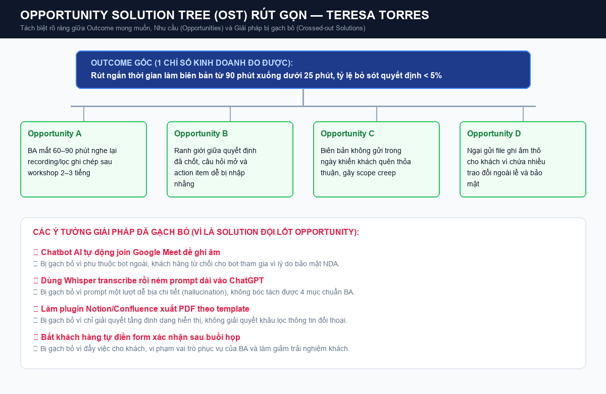
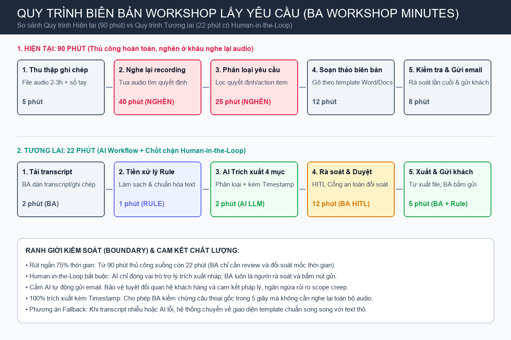

# Báo cáo nhóm — Day 02 Discovery & Problem Framing

> Bản chung của nhóm, viết trên repo do nhóm trưởng fork. Không copy file này sang repo cá nhân.
> Template chi tiết và prompt mẫu: [docs/01-worksheet.md](../../docs/01-worksheet.md). Bài mẫu: [docs/02-deliverable-example.md](../../docs/02-deliverable-example.md).

## 1. Thông tin nhóm

- Tên nhóm: NhomQuan
- Thành viên: xem `TEAM.md` (Nguyễn Anh Quân - 2A202603892, Võ Thị Phương Nhung - 2A202603918, Nguyễn Minh Thành - 2A202603884)
- Candidate problem được chọn (1 câu): Khi vừa kết thúc workshop lấy yêu cầu với khách hàng, tôi muốn có biên bản gồm yêu cầu, quyết định, câu hỏi mở và việc cần làm, để gửi khách xác nhận trong ngày
- Quyết định cuối: Go (với điều kiện áp dụng kiến trúc Workflow có Human-in-the-loop để BA duyệt trước khi gửi)

---

## 2. Hội tụ nhóm (CP3)

### 2.1. Pitch

| # | Người đưa ra | Candidate (Job Story ngắn) | Actor | Bottleneck | Câu hỏi phản biện nhận được (ai hỏi) |
|---:|---|---|---|---|---|
| 1 | Quân | Khi nhận được lời mời phỏng vấn kỹ thuật/tình huống vào ngày mai, tôi muốn tổng hợp các câu hỏi phỏng vấn thường gặp dựa trên chính các yêu cầu trong JD, để luyện tập câu trả lời có trọng tâm mà không bị bỡ ngỡ | Sinh viên năm cuối / Ứng viên mới ra trường | Tốn 2-3h tự đọc JD, search Google từng keyword; câu hỏi generic không sát JD | Mỗi công ty và người phỏng vấn có phong cách hỏi rất khác nhau, câu hỏi sinh từ JD có sát thực tế phỏng vấn không? (Nhung hỏi) |
| 2 | Quân | Khi cần nộp bài tập lớn trong tuần thi, tôi muốn tìm lại nhanh link nộp bài và tiêu chí chấm điểm bị trôi trong kênh chat nhóm/lớp, để nộp đúng hạn và đủ yêu cầu mà không phải tag hỏi lại lớp trưởng | Sinh viên đại học | Tin nhắn trôi hàng trăm tin mỗi ngày trong Zalo/Discord, ghim tin nhắn bị trôi hoặc lẫn lộn | Zalo/Discord đều có tính năng Search và Pin message, tại sao không dùng rule/hashtag đơn giản thay vì cần AI? (Thành hỏi) |
| 3 | Quân | Khi làm bài tập lớn theo nhóm 4-5 người, tôi muốn theo dõi tiến độ công việc và trạng thái nộp bài của từng thành viên theo thời gian thực, để kịp thời nhắc nhở và phân phối lại việc trước hạn chót 3 ngày | Trưởng nhóm sinh viên (Team leader) | Thành viên báo cáo rời rạc qua chat, leader phải gom và tổng hợp thủ công vào bảng tính mất 30-45 phút/lần | Trello hay Notion đã có sẵn bảng Kanban và notification nhắc việc, vấn đề chính là ở ý thức thành viên hay công cụ theo dõi? (Nhung hỏi) |
| 4 | Thành | Khi bắt đầu tuần mới vào sáng thứ Hai, tôi muốn tổng hợp kết quả huấn luyện mô hình và log lỗi của tuần trước vào một chỗ, để báo cáo tiến độ cho tech lead trước 10h (#1) | AI / Data Engineer | Quy trình lặp lại hằng tuần, tốn thời gian đào bới log và metric, có baseline đo thực tế | Phần đánh giá chất lượng nhận định tự động đo thế nào? Có cần chuyên môn kỹ thuật sâu để verify số liệu không? (Quân hỏi) |
| 5 | Thành | Khi tiếp nhận module hệ thống mới hoặc refactor mã nguồn cũ, tôi muốn tìm lại các quyết định thiết kế và lý do kiến trúc trước đây, để chỉnh sửa mà không vi phạm nguyên tắc ban đầu (#2) | Software Engineer / Tech Lead | Pain chung của cả team, tốn thời gian đào bới chat/PR/Confluence cũ | Quyền truy cập và phân loại dữ liệu chat lịch sử phức tạp, liệu có lấy đủ ngữ cảnh bảo mật không? (Nhung hỏi) |
| 6 | Thành | Khi nhận tài liệu đặc tả kiến trúc kỹ thuật hoặc PR lớn hơn 1000 dòng code, tôi muốn có bản tóm tắt các thay đổi cốt lõi và cảnh báo rủi ro tương thích, để review nhanh mà không bỏ sót lỗi logic (#3) | Senior Dev / Tech Lead | Tốn nhiều thời gian đọc hiểu tài liệu và diff phức tạp (45-60 phút/bản) | Chất lượng review phụ thuộc nhiều vào ngữ cảnh dự án và nghiệp vụ ẩn, AI tóm tắt có đảm bảo không bỏ sót side-effect? (Quân hỏi) |
| 7 | Nhung | Khi vừa kết thúc workshop lấy yêu cầu với khách hàng, tôi muốn có biên bản gồm yêu cầu, quyết định, câu hỏi mở và việc cần làm, để gửi khách xác nhận trong ngày (#2) | Business Analyst (BA) | Quy trình rõ, lặp lại sau mỗi buổi workshop, dễ bấm giờ (mất 60-90 phút nghe lại recording/lọc ghi chép) | Khách hàng có cho ghi âm và đưa nội dung họp vào công cụ AI không? Xử lý bảo mật thông tin bí mật kinh doanh (NDA) ra sao? (Thành hỏi) |
| 8 | Nhung | Khi khách hàng gửi yêu cầu thay đổi (Change Request - CR) giữa sprint, tôi muốn phân tích nhanh phạm vi ảnh hưởng tới các tính năng hiện tại, để ước lượng chi phí và thời gian chính xác (#1) | Project Manager / BA | Ảnh hưởng trực tiếp tới estimate và tiến độ dự án; tài liệu rải rác nhiều nơi | Tài liệu rải rác nhiều nơi (Jira, Figma, code); chất lượng phân tích khó đo và rủi ro estimate sai rất cao? (Quân hỏi) |
| 9 | Nhung | Khi dev đặt câu hỏi làm rõ đặc tả nghiệp vụ, tôi muốn phân loại câu hỏi và tra cứu nhanh các đoạn tài liệu liên quan, để phản hồi trong vòng 30 phút mà không ngắt quãng dòng tư duy (#5) | Business Analyst (BA) | Nhiều người bị ảnh hưởng, đếm được số câu hỏi lặp đi lặp lại hàng ngày | Nguyên nhân có thể nằm ở quy trình review đặc tả từ đầu chưa kỹ, không chỉ ở cách viết hay tra cứu? (Thành hỏi) |

### 2.2. Cluster

| Cluster | Các candidate | Pattern chung |
|---|---|---|
| A — Review thông tin tốn thời gian | #1 (Luyện phỏng vấn theo JD - Quân), #6 (Review tài liệu kỹ thuật dài - Thành), #8 (Phân tích ảnh hưởng CR - Nhung) | Người dùng phải đọc và xử lý khối lượng lớn văn bản kỹ thuật/nghiệp vụ phức tạp; tiêu tốn tải nhận thức (cognitive load) cao để phân tích, đối chiếu và đánh giá |
| B — Phân loại dữ liệu & thông tin rời rạc | #2 (Tìm link nộp bài/deadline - Quân), #5 (Tìm quyết định thiết kế cũ - Thành), #9 (Dev hỏi lại đặc tả - Nhung) | Thông tin bị phân mảnh qua nhiều kênh giao tiếp (chat, email, PR, wiki, doc), thiếu gắn thẻ phân loại, khiến việc định tuyến, lọc và tra cứu lại mất nhiều công sức |
| C — Tổng hợp dữ liệu quy mô lớn & tạo biên bản/báo cáo định kỳ | #3 (Theo dõi tiến độ task nhóm - Quân), #4 (Tổng hợp báo cáo thử nghiệm & tiến độ tuần - Thành), #7 (Biên bản workshop lấy yêu cầu - Nhung) | Dữ liệu đầu vào thô phát sinh định kỳ với khối lượng lớn (audio thảo luận 2-3h, log thử nghiệm mô hình, báo cáo task), cần trích xuất có cấu trúc (quyết định, action items, kết quả) để báo cáo/chốt với stakeholder |

### 2.3. Opportunity Solution Tree rút gọn

Gốc là **1 outcome**. Nhánh là **opportunity** (nhu cầu, pain), không phải tính năng hay công cụ.

```text
OUTCOME: Rút ngắn thời gian phát hành biên bản workshop lấy yêu cầu từ 90 phút xuống dưới 25 phút trong khi giữ tỷ lệ bỏ sót quyết định < 5%
├── Opportunity A: BA mất 60–90 phút nghe lại recording hoặc đọc ghi chép phân mảnh để gom thông tin sau workshop kéo dài 2-3 tiếng
├── Opportunity B: Ranh giới giữa "yêu cầu đã chốt", "câu hỏi mở cần xác nhận thêm", và "action item giao cho ai" dễ bị nhập nhằng trong lúc thảo luận dồn dập
├── Opportunity C: Biên bản không được gửi trong ngày dẫn đến khách hàng quên thỏa thuận miệng, phát sinh tranh cãi và scope creep về sau
└── Opportunity D: Ngại chia sẻ transcript hoặc recording thô cho khách hàng vì chứa nhiều trao đổi ngoài lề và dữ liệu nhạy cảm
```



Những ý đã gạch bỏ vì là solution đội lốt opportunity:

- ~Xây dựng chatbot AI tự động tham gia Google Meet/Teams để ghi âm và tóm tắt cuộc họp~ *(Solution: phụ thuộc bot ngoài, khách hàng từ chối cho bot tham gia vì lý do bảo mật dữ liệu doanh nghiệp và NDA)*
- ~Dùng Whisper transcribe toàn bộ audio ra text rồi ném prompt dài vào ChatGPT để sinh biên bản~ *(Solution: prompt một lượt dễ hallucinate, không phân loại được context nghiệp vụ và bỏ sót quyết định ngầm định)*
- ~Tạo plugin Notion/Confluence tự động xuất biên bản PDF theo template cố định~ *(Solution: chỉ giải quyết việc hiển thị/định dạng, không giải quyết bottleneck trích xuất quyết định từ thảo luận hỗn loạn)*
- ~Bắt khách hàng tự điền form xác nhận yêu cầu sau buổi họp~ *(Solution: đẩy trách nhiệm cho khách hàng, vi phạm vai trò phục vụ của BA và làm giảm trải nghiệm khách hàng)*

### 2.4. Chấm điểm shortlist (1–5)

| Candidate | Actor rõ | Quy trình rõ | Pain có bằng chứng | Impact đo được | Vừa sức lab | So sánh được No AI/Rule/Workflow/Agent | Nhóm hiểu domain | Tổng |
|---|---:|---:|---:|---:|---:|---:|---:|---:|
| 1. Chuẩn bị phỏng vấn kỹ thuật theo JD (Quân) | 4 | 3 | 3 | 2 | 4 | 3 | 5 | 24 |
| 2. Biên bản workshop lấy yêu cầu khách hàng (Nhung) | 5 | 5 | 5 | 5 | 5 | 5 | 4 | **34** |
| 3. Tổng hợp báo cáo thử nghiệm & log lỗi tuần (Thành) | 5 | 4 | 4 | 4 | 3 | 4 | 3 | 27 |

**Candidate được chọn:**
Candidate 2: *"Khi vừa kết thúc workshop lấy yêu cầu với khách hàng, tôi muốn có biên bản gồm yêu cầu, quyết định, câu hỏi mở và việc cần làm, để gửi khách xác nhận trong ngày"* (Bài toán công việc của Business Analyst - BA).

**Vì sao chọn:**

1. **Actor và quy trình nghiệp vụ cực kỳ chuẩn hóa trong thực tế:** BA trong các công ty phần mềm/dịch vụ CNTT có quy trình làm việc chuẩn sau workshop: Ghi chép/audio → Rà soát → Lọc yêu cầu, quyết định, câu hỏi mở, action items → Soạn biên bản chuẩn → Gửi khách hàng xác nhận. Quy trình này không bị phụ thuộc vào sở thích cá nhân.
2. **Baseline đo lường rõ ràng, định lượng bằng thời gian thực tế:** Mỗi buổi workshop kéo dài 2–3 giờ ngốn trung bình từ 60–90 phút của BA để hoàn thiện biên bản. Mục tiêu rút ngắn xuống dưới 25 phút review là một metric thành công có thể bấm giờ đo lường trực tiếp, không phụ thuộc vào cảm tính.
3. **Giá trị kinh doanh (Business Impact) trực tiếp và trọng yếu:** Biên bản gửi trong ngày giúp "khóa scope" kịp thời, tránh rủi ro "scope creep" (khách hàng thêm việc ngoài hợp đồng) và hiểu nhầm yêu cầu, giúp doanh nghiệp tiết kiệm hàng nghìn USD chi phí làm lại (rework).
4. **Điểm can thiệp AI và ranh giới an toàn (Human-in-the-Loop) rõ ràng:** AI chỉ đóng vai trò trợ lý trích xuất và phân loại cấu trúc thông tin sơ bộ từ bản ghi chép/transcript; BA luôn là người rà soát cuối cùng (human gatekeeper) trước khi gửi cho khách. Hệ thống không tự ý phát hành tài liệu ra bên ngoài, đảm bảo an toàn nghiệp vụ tuyệt đối.
5. **So sánh rõ nét cả 4 mức độ giải pháp:**
   - *No AI:* Dùng template Word/Notion chuẩn để gõ tay trực tiếp.
   - *Rule:* Dùng regex hoặc script lọc theo các cú pháp tag cố định (ví dụ `@decision`, `@action`).
   - *Workflow:* Speech-to-text (hoặc transcript) → LLM trích xuất và phân loại thành 4 mục độc lập → BA kiểm tra, chỉnh sửa → Gửi email (mức phù hợp nhất).
   - *Agent:* Tự động phân tích hội thoại, tự động tạo ticket Jira, tự động gửi email cho khách mà không qua người duyệt (mức rủi ro cao, không khuyến nghị).
6. **Vừa sức và dễ kiểm chứng nhanh trong phạm vi môn học:** Cả nhóm có thể dễ dàng tiếp cận phỏng vấn các anh/chị BA, PM đang đi làm để thu thập interview snapshot thực tế, đồng thời kiểm thử ngay prototype trích xuất trên transcript cuộc họp mẫu.

**Vì sao loại các candidate còn lại:**

- **Loại Candidate 1 (Chuẩn bị phỏng vấn theo JD của Quân):**
  - *Impact khó đo lường khách quan:* Kết quả đỗ hay trượt phỏng vấn phụ thuộc vào rất nhiều biến số phi kỹ thuật (body language, sự ăn ý văn hóa, tâm lý của interviewer, mức độ cạnh tranh của các ứng viên khác). Rất khó chứng minh việc AI sinh câu hỏi có giúp tăng tỷ lệ đậu phỏng vấn hay không.
  - *Quy trình không chuẩn hóa:* Mỗi sinh viên có phong cách ôn tập khác nhau, không có baseline thời gian hay tài liệu chuẩn cố định.
  - *Giá trị thặng dư của giải pháp thấp:* Người dùng hoàn toàn có thể tự copy JD vào ChatGPT bản miễn phí để hỏi vài câu prompt đơn giản mà không cần đến một hệ thống hay workflow chuyên biệt.
- **Loại Candidate 3 (Tổng hợp báo cáo thử nghiệm & log lỗi tuần của Thành):**
  - *Thiên về Rule/Script/Dashboard hơn là bài toán AI:* Việc gom log lỗi và tổng hợp chỉ số huấn luyện (accuracy, loss, latency) đã có các công cụ MLOps chuyên dụng giải quyết rất tốt và chính xác 100% bằng rule-based (như TensorBoard, MLflow, Weights & Biases, Grafana). Dùng AI ở đây là "dùng dao mổ trâu giết gà".
  - *Rủi ro ảo giác (Hallucination) nguy hiểm về số liệu:* AI tóm tắt có xu hướng làm tròn hoặc bịa số liệu metric và log kỹ thuật — điều tối kỵ trong báo cáo kỹ thuật cho Tech Lead.
  - *Khó tiếp cận tệp người dùng rộng:* Đối tượng AI Engineer làm việc với training log hẹp hơn nhiều so với vị trí BA - vai trò có mặt ở mọi dự án phần mềm.

**Xử lý bất đồng (nếu có):**
Ban đầu Quân rất tâm đắc với Candidate 1 vì bài toán sinh viên luyện phỏng vấn rất gần gũi với trải nghiệm cá nhân của mình. Tuy nhiên, sau khi Thành và Nhung chỉ ra điểm yếu chí mạng về việc khó đo lường success metric và khó xây dựng quy trình chuẩn hóa doanh nghiệp, cả nhóm đã cùng chấm điểm khách quan qua ma trận 7 tiêu chí. Kết quả cho thấy bài toán của BA (Candidate 2) vượt trội về tính khả thi, baseline đo được và giá trị kinh doanh. Quân đã hoàn toàn bị thuyết phục và đồng thuận chọn Candidate 2, đồng thời nhận trách nhiệm chính phụ trách vẽ sơ đồ quy trình chi tiết trước/sau ở CP5.

---

## 3. Kiểm chứng + research giải pháp đã có (CP4)

### 3.1. Assumption Map

| # | Giả định | Loại (Value / Usability / Feasibility / Viability) | Quan trọng (1–5) | Đã có bằng chứng (1–5) | Kiểm chứng trước? |
|---:|---|---|---:|---:|---|
| 1 | Các BA khác cũng mất từ 60–90 phút sau mỗi buổi workshop 2–3 tiếng để tổng hợp biên bản họp | Value | 5 | 4 | ✅ Có |
| 2 | Khách hàng và PM yêu cầu bắt buộc phải gửi biên bản ngay trong ngày để chốt scope và tránh tranh cãi | Value | 5 | 3 | ✅ Có |
| 3 | Khách hàng và công ty đồng ý đưa nội dung ghi âm/ghi chép thô vào công cụ AI xử lý (vấn đề bảo mật/NDA) | Viability | 5 | 2 | ✅ Có |
| 4 | Mô hình AI có khả năng bóc tách chính xác quyết định, câu hỏi mở và việc cần làm từ đoạn hội thoại tự nhiên lộn xộn | Feasibility | 5 | 2 | ✅ Có |
| 5 | BA dễ dàng đọc hiểu, tin tưởng và sửa được bản nháp do AI sinh ra nhanh hơn việc tự viết tay từ đầu | Usability | 4 | 3 | — (Sau lab) |

Giả định nhóm kiểm chứng trong buổi này: **Giả định #1, #2 và #3** (tập trung vào mức độ nhức nhối thực tế của pain point, yêu cầu thời gian phát hành biên bản và rào cản bảo mật/chính sách bảo mật dữ liệu doanh nghiệp).

---

### 3.2. Kiểm chứng

Cách đã dùng: **Phỏng vấn sâu theo phương pháp The Mom Test** (phỏng vấn 3 người: 1 Senior BA, 1 Project Manager và 1 Junior BA; đặt câu hỏi về hành vi và sự việc cụ thể đã xảy ra trong quá khứ, không hỏi câu hỏi giả định hoặc xin lời khen).

#### Interview snapshot 1 — Senior Business Analyst ([Xem file chi tiết](../assets/cp4-interview-snapshot-1.md))
| Trường | Nội dung |
|---|---|
| Người được hỏi | Chị L. — Senior BA, 4 năm kinh nghiệm tại công ty Outsourcing phần mềm quy mô 180 người |
| Câu nói đáng nhớ nhất (nguyên văn) | *"Buổi workshop 2 tiếng rưỡi với khách xong là mình ù hết cả tai. Ngồi nghe lại recording và gõ biên bản mất đúng 80 phút. Mệt nhất là đoạn khách nói chêm tiếng Anh tiếng Việt và thay đổi ý liên tục, không gửi chốt trong ngày là hôm sau họ quên sạch thỏa thuận miệng."* |
| Lần gần nhất gặp vấn đề này: chuyện gì đã xảy ra? | Thứ Năm tuần trước, trong workshop lấy yêu cầu cho phân hệ cổng thanh toán của dự án Fintech. Họp từ 14h đến 16h30, chị phải ở lại văn phòng đến gần 19h để nghe lại các đoạn tranh luận và soạn biên bản gửi khách. |
| Hiện đang xử lý bằng cách nào (workaround)? | Mở song song 2 cửa sổ: một bên mở file recording tua tốc độ 1.5x, một bên mở Google Docs gõ lại theo template có sẵn của công ty. |
| Mất bao lâu, bao lần? | Trung bình 70–90 phút cho mỗi biên bản sau workshop dài; trung bình 2–3 buổi workshop mỗi tuần trong giai đoạn đầu dự án (Inception/Discovery). |
| Insight / opportunity rút ra | Nỗi đau lớn nhất không phải là gõ chữ, mà là **công sức nghe lại audio để định vị chính xác quyết định cuối cùng giữa một chuỗi tranh cãi qua lại**. |

#### Interview snapshot 2 — Project Manager / Delivery Manager ([Xem file chi tiết](../assets/cp4-interview-snapshot-2.md))
| Trường | Nội dung |
|---|---|
| Người được hỏi | Anh H. — PM kiêm Delivery Manager, 7 năm kinh nghiệm quản lý dự án phần mềm doanh nghiệp |
| Câu nói đáng nhớ nhất (nguyên văn) | *"Nếu BA không gửi MoM (Minutes of Meeting) trong vòng 24 giờ, thì sang tuần sau dev làm xong khách lại bảo: 'Ủa hôm nọ tôi nói khác cơ mà'. Scope creep (phình phạm vi) toàn bắt nguồn từ việc không có biên bản bằng văn bản chốt ngay sau họp."* |
| Lần gần nhất gặp vấn đề này: chuyện gì đã xảy ra? | Cách đây 3 tuần, đội dự án mất 4 ngày công (man-days) để đập đi làm lại một luồng phê duyệt đơn hàng chỉ vì BA chỉ ghi chú trong sổ tay cá nhân mà quên gửi email chốt quyết định cho khách hàng xác nhận. |
| Hiện đang xử lý bằng cách nào (workaround)? | Đưa quy định cứng vào quy trình dự án: BA bắt buộc phải gửi email biên bản họp trước 18h cùng ngày hoặc trước 9h sáng hôm sau, CC toàn bộ ban dự án. |
| Mất bao lâu, bao lần? | Xảy ra ở 100% các dự án; rủi ro tranh cãi scope xuất hiện ít nhất 1–2 lần mỗi sprint nếu không có biên bản chặt chẽ. |
| Insight / opportunity rút ra | Biên bản workshop không chỉ là ghi chép nội bộ mà là **căn cứ pháp lý - nghiệp vụ quan trọng nhất** để bảo vệ đội ngũ phát triển trước rủi ro làm thêm việc không tính phí. |

#### Interview snapshot 3 — Junior Business Analyst ([Xem file chi tiết](../assets/cp4-interview-snapshot-3.md))
| Trường | Nội dung |
|---|---|
| Người được hỏi | Bạn M. — Junior BA, 1 năm kinh nghiệm tại công ty sản phẩm SaaS |
| Câu nói đáng nhớ nhất (nguyên văn) | *"Mình từng thử ném file transcript vào ChatGPT để nhờ nó tóm tắt, nhưng nó toàn tóm tắt kiểu văn mẫu chung chung. Cái mình cần nhất là: Quyết định chốt gì? Việc gì cần làm và ai chịu trách nhiệm? thì nó lại bỏ sót hoặc tự bịa ra mốc thời gian."* |
| Lần gần nhất gặp vấn đề này: chuyện gì đã xảy ra? | Đầu tuần trước, dùng ChatGPT để tóm tắt buổi họp nội bộ với Tech Lead và Product Owner, kết quả AI bỏ sót 2 câu hỏi mở về cấu trúc database, khiến buổi họp tiếp theo lại phải bàn lại từ đầu. |
| Hiện đang xử lý bằng cách nào (workaround)? | Tự tay ghi chép thô trong lúc họp (dùng bullet points), sau đó vừa đối chiếu ghi chép vừa tự lọc ra bảng danh mục: Yêu cầu / Quyết định / Câu hỏi mở / Action Items. |
| Mất bao lâu, bao lần? | Mất khoảng 60 phút mỗi lần; cảm giác rất căng thẳng vì vừa phải điều phối thảo luận vừa phải ghi chép sợ sót ý. |
| Insight / opportunity rút ra | AI tổng quát không đáp ứng được yêu cầu vì thiếu cấu trúc phân loại nghiệp vụ chuyên biệt của BA; người dùng cần **bằng chứng đối soát (traceability/timestamp)** để kiểm tra lại tính chính xác trước khi gửi. |

#### Tổng hợp kết quả kiểm chứng:

| Nguồn | Số người / số mẫu | Tín hiệu xác nhận | Tín hiệu phản bác |
|---|---:|---|---|
| Phỏng vấn sâu BA & PM (The Mom Test) | 3 người (1 Senior BA, 1 PM, 1 Junior BA) | - 3/3 người xác nhận mất từ 60–90 phút để soạn biên bản sau workshop.<br>- 3/3 khẳng định việc gửi biên bản trong ngày là bắt buộc để tránh scope creep.<br>- 2/3 từng thử AI nhưng thất vọng vì tóm tắt chung chung và thiếu trích dẫn bằng chứng. | - Cả 3 người đều cảnh báo: **Khách hàng không bao giờ đồng ý cho bot AI bên thứ ba tham gia phòng họp** (vì lý do bảo mật NDA và tâm lý e ngại).<br>- Dữ liệu họp không được đẩy lên các dịch vụ AI công cộng không có cam kết bảo mật. |
| Khảo sát nhanh cộng đồng BA (Quick Poll) | 8 BA đang làm việc tại các công ty IT | - 7/8 người bình chọn bước "Nghe lại recording và lọc quyết định" là bước tốn thời gian và mệt mỏi nhất.<br>- 8/8 đồng ý muốn có công cụ tự động phân loại theo 4 mục chuẩn (Yêu cầu, Quyết định, Câu hỏi mở, Việc cần làm). | - 2/8 người cho biết với các cuộc họp trao đổi ngắn (dưới 15 phút), họ chỉ cần ghi 2 dòng trong Jira/Slack là đủ, không cần làm biên bản chính thức. |

**Nhóm đã sửa problem thế nào sau kiểm chứng:**
1. **Thu hẹp phạm vi đầu vào:** Loại bỏ hoàn toàn ý tưởng "Chatbot AI tham gia họp Google Meet/Teams để tự ghi âm". Thay vào đó, giải pháp chuyển thành **nhận đầu vào là file ghi chép thô hoặc transcript do chính BA chủ động tải lên sau cuộc họp**, giải quyết triệt để rào cản bảo mật và quy định NDA của khách hàng.
2. **Bắt buộc có tính năng đối soát nguồn (Traceability):** Mọi quyết định và việc cần làm do AI trích xuất phải kèm theo **timestamp** hoặc đoạn trích nguyên văn tương ứng trong transcript để BA có thể click kiểm tra lại trong 5 giây mà không cần nghe lại cả đoạn dài.
3. **Cố định cấu trúc đầu ra 4 danh mục của BA:** Không để AI tóm tắt tự do thành đoạn văn xuôi, mà bắt buộc ép cấu trúc thành 4 bảng rõ ràng: (1) Yêu cầu nghiệp vụ mới, (2) Quyết định đã thống nhất, (3) Câu hỏi mở cần khách hàng xác nhận thêm, (4) Việc cần làm (Action Items kèm người phụ trách và deadline).

---

### 3.3. Research giải pháp đã có

| Công cụ / case / pattern | Link | Giải bước nào trong quy trình? | Điểm mạnh | Khoảng trống / rủi ro | Bài học cho nhóm |
|---|---|---|---|---|---|
| **Otter.ai / Fireflies.ai** | [https://otter.ai](https://otter.ai) & [https://fireflies.ai](https://fireflies.ai) | Tự động ghi âm, speech-to-text và sinh bản tóm tắt cuộc họp (Meeting Summary) | Tự động hóa cao, nhận diện giọng nói tiếng Anh rất tốt, tích hợp sẵn lịch Zoom/Teams | - Phải thả bot AI vào phòng họp (gây khó chịu và vi phạm NDA doanh nghiệp tại VN).<br>- Tóm tắt dạng văn xuôi chung chung, không phân loại chuẩn 4 mục chuyên ngành BA.<br>- Xử lý tiếng Việt chêm tiếng Anh (Vietlish) còn nhiều sai sót. | **Không dùng bot tham gia phòng họp.** Nhận file transcript/audio từ người dùng để tôn trọng bảo mật; thiết kế cấu trúc trích xuất chuyên biệt cho nghiệp vụ BA. |
| **Atlassian Intelligence (trong Jira/Confluence)** | [https://www.atlassian.com/software/confluence/features/atlassian-intelligence](https://www.atlassian.com/software/confluence/features/atlassian-intelligence) | Từ ghi chép thô trong trang Confluence, AI định dạng lại thành danh sách Action Items và tóm tắt cuộc họp | Nằm sẵn trong hệ sinh thái làm việc của đội phát triển phần mềm; liên kết trực tiếp tạo Jira issue | - Chỉ xử lý văn bản ghi chép sẵn, không xử lý audio/transcript cuộc họp dài đối thoại hỗn loạn.<br>- Phụ thuộc vào việc BA đã phải tự nghe và gõ trước nội dung khá mạch lạc. | **Tập trung giải quyết khâu trích xuất từ dữ liệu thô đối thoại**, nơi tốn thời gian nghe lại nhất của BA. |
| **Granola** | [https://www.granola.so](https://www.granola.so) | Kết hợp giữa ghi chú nhanh của con người trong lúc họp với transcript âm thanh để tạo biên bản có cấu trúc | Không dùng bot tham gia phòng họp (chạy ngầm trên máy cá nhân); tôn trọng sự chủ động của người dùng; biên bản giữ được giọng điệu chuyên nghiệp | - Chưa hỗ trợ tốt ngôn ngữ tiếng Việt và các thuật ngữ chuyên ngành IT Việt Nam.<br>- Chưa tùy biến sâu theo template biên bản nghiệm thu/chốt yêu cầu chuẩn doanh nghiệp. | **Mô hình phối hợp Người + AI lý tưởng (Augmented Intelligence):** Con người nắm ngữ cảnh chính, AI hỗ trợ bù đắp chi tiết và trích xuất cấu trúc chuẩn. |

---

## 4. Quy trình trước/sau (CP5)

### 4.1. Quy trình hiện tại

Sơ đồ quy trình hiện tại (Baseline: **90 phút** sau mỗi buổi workshop kéo dài 2–3 tiếng):

```text
HIỆN TẠI — Tổng thời gian: 90 phút

[1. Thu thập ghi chép & file audio workshop: 5']
       │
       ▼
[2. Nghe lại recording & rà soát sổ tay/Docs: 40'] 
       │
       ▼
[3. Phân loại yêu cầu, quyết định, việc cần làm: 25'] ◄── BOTTLENECK CHÍNH (Tốn 65/90 phút)
       │
       ▼
[4. Soạn thảo biên bản hoàn chỉnh theo template: 12']
       │
       ▼
[5. Tự kiểm tra, đối soát lại & gửi email cho khách: 8']
```

| Bước | Actor | Input | Output | Thời gian / tần suất | Ghi chú |
|---:|---|---|---|---|---|
| 1 | BA | Buổi workshop vừa kết thúc, file recording (nếu có) và sổ tay ghi chép nhanh | File recording tải về máy + ghi chép phân mảnh trên Notepad/Docs | 5 phút / sau mỗi buổi họp | Nhiều ghi chép viết tắt, lộn xộn, thiếu ngữ cảnh |
| 2 | BA | File recording dài 120–180 phút + ghi chép thô | Các đoạn âm thanh quan trọng được tua đi tua lại để nghe rõ | 40 phút / buổi họp | **Rất mệt mỏi:** phải tua tới tua lui để tìm lại ai nói gì ở phút nào |
| 3 | BA | Thông tin đã lọc từ recording và ghi chép | Danh sách sơ bộ các quyết định đã chốt, yêu cầu mới và câu hỏi còn treo | 25 phút / buổi họp | **Bottleneck:** Khó phân định ranh giới giữa ý kiến thảo luận và quyết định chính thức |
| 4 | BA | Danh sách thông tin đã phân loại | Bản thảo biên bản cuộc họp hoàn chỉnh (Meeting Minutes) | 12 phút / buổi họp | Điền nội dung vào template Word/Confluence chuẩn của công ty |
| 5 | BA | Bản thảo biên bản cuộc họp | Email gửi khách hàng đính kèm biên bản yêu cầu xác nhận | 8 phút / buổi họp | BA đọc lại một lượt rồi gửi email CC các bên liên quan |

**Bottleneck chính:** Bước 2 và Bước 3 (ngốn tổng cộng **65 / 90 phút**, chiếm hơn 72% tổng thời gian). BA phải tiêu tốn tải nhận thức rất lớn để nghe lại một buổi họp dài, rà soát lại các cuộc tranh luận để xác định đâu là quyết định cuối cùng và đâu là việc cần làm tiếp theo.

---

### 4.2. Quy trình tương lai

Quy trình tương lai áp dụng kiến trúc **Workflow kết hợp Human-in-the-loop (HITL)**. Tổng thời gian giảm xuống còn **22 phút** (tiết kiệm ~75% thời gian):



```text
TƯƠNG LAI — Tổng thời gian: 22 phút (Giảm từ 90' xuống 22')

[1. Tải lên transcript / ghi chép thô] ──(Con người - BA: 2')
       │
       ▼
[2. Tiền xử lý & làm sạch văn bản] ──(RULE: 1') 
       │ (Tách đoạn, lọc khoảng trắng, nhận diện tag mốc thời gian)
       ▼
[3. Trích xuất & Phân loại vào 4 mục chuẩn] ──(AI - LLM: 2')
       │ (Bóc tách: Yêu cầu / Quyết định / Câu hỏi mở / Action Items + Timestamp)
       ▼
[4. Rà soát, đối soát timestamp & chỉnh sửa] ──(CON NGƯỜI - BA [HITL Chốt chặn]: 12') ◄── BOTTLENECK MỚI
       │ 
       ├─► [Nếu AI trích xuất chuẩn] ──► Chuyển sang Bước 5
       └─► [Nếu AI bị sót / ảo giác] ──► Nhấn "Xem đoạn trích gốc" chỉnh sửa trực tiếp (FALLBACK)
       │
       ▼
[5. Xuất biên bản chuẩn & Gửi email xác nhận] ──(RULE + CON NGƯỜI: 5')
       │ (Hệ thống xuất format Word/Markdown; BA bấm nút gửi email)
```

**Phân định trách nhiệm và công nghệ trong từng bước:**
- **Bước 1 (Con người - BA):** BA tải transcript cuộc họp (hoặc paste bản ghi chép thô) vào hệ thống nội bộ.
- **Bước 2 (Rule):** Script kiểm tra định dạng, chuẩn hóa định dạng thời gian (timestamp), loại bỏ các khoảng trắng thừa và ký tự rác.
- **Bước 3 (AI - LLM):** Prompt chuyên biệt cho nghiệp vụ BA phân tích ngữ cảnh hội thoại, bóc tách và phân loại thông tin vào đúng 4 bảng danh mục:
  1. *Yêu cầu tính năng mới / thay đổi (Requirements)*
  2. *Quyết định đã thống nhất giữa hai bên (Agreed Decisions)*
  3. *Câu hỏi mở cần xác nhận thêm (Open Questions)*
  4. *Việc cần làm tiếp theo (Action Items - có người phụ trách & deadline)*
  *Mỗi mục trích xuất bắt buộc phải gắn kèm timestamp tương ứng trong transcript gốc.*
- **Bước 4 (Con người - Human-in-the-loop [Cổng an toàn bắt buộc]):** BA đọc lướt bản nháp được phân loại sẵn. Nếu có mục nào chưa chắc chắn, BA chỉ cần click vào timestamp để xem đoạn đối thoại nguyên văn. BA thực hiện chỉnh sửa, thêm bớt từ ngữ chuyên môn.
- **Boundary tuyệt đối:** AI **tuyệt đối không được phép tự động phát hành biên bản hay gửi email cho khách hàng**. Mọi nội dung gửi đi phải do con người phê duyệt.
- **Phương án quay về (Fallback):** Nếu file transcript quá ồn hoặc AI gặp sự cố kết nối, hệ thống tự động hiển thị template biên bản chuẩn hóa trống kèm file ghi chép thô cạnh nhau để BA thao tác thủ công bình thường, không làm gián đoạn công việc.
- **Bước 5 (Rule + Con người):** Hệ thống tự động render biên bản sang định dạng chuyên nghiệp (Word/PDF/Markdown); BA duyệt lần cuối và bấm gửi email cho khách hàng.

---

### 4.3. Bảng so sánh Before / After

| Chỉ số | Trước | Sau (kỳ vọng) | Ghi chú |
|---|---:|---:|---|
| **Số bước thực hiện** | 5 bước | 5 bước | Giữ nguyên độ chặt chẽ của quy trình, không cắt xén bước kiểm soát |
| **Tổng thời gian xử lý** | 90 phút | **22 phút** | **Giảm 68 phút (~75% thời gian)**, giải phóng BA khỏi việc nghe lại audio thủ công |
| **Số bước thao tác thủ công** | 5 bước | 2 bước (Bước 1 và Bước 4) | BA chỉ tập trung vào khâu đầu vào và khâu rà soát chuyên môn |
| **Bottleneck chính** | Nghe lại audio và tự phân loại (65 phút) | Rà soát và chỉnh sửa bản nháp có timestamp (12 phút) | Chuyển từ "tự tạo nội dung từ trang trắng" sang "chuyên gia soát lỗi bản nháp" |
| **Rủi ro mới phát sinh** | Bỏ sót thỏa thuận miệng do mệt mỏi, gửi trễ biên bản sau 24h | Nguy cơ AI phân loại nhầm giữa "ý kiến đề xuất" thành "quyết định đã chốt" | Được ngăn chặn triệt để bằng cổng kiểm duyệt HITL ở Bước 4 |

---

## 5. Problem Statement v0 (CP5)

| Trường | Nội dung |
|---|---|
| **Actor** | Business Analyst (BA) phụ trách lấy yêu cầu trong các dự án phát triển phần mềm |
| **Quy trình** | Sau khi kết thúc workshop 2–3 tiếng với khách hàng: Thu thập ghi chép/audio → Nghe lại recording → Lọc yêu cầu, quyết định, việc cần làm → Soạn biên bản theo template → Gửi email cho khách hàng xác nhận trong ngày |
| **Bottleneck** | Bước nghe lại recording và phân loại thủ công các quyết định bị nói rải rác trong cuộc họp (mất từ 60–90 phút) |
| **Impact** | Tốn 3–5 giờ/tuần cho mỗi BA; 40% biên bản gửi trễ sau 24h khiến khách hàng quên thỏa thuận miệng, dẫn đến nguy cơ phình phạm vi (scope creep) và tranh cãi dự án |
| **Success Metric** | - Thời gian hoàn thành biên bản giảm từ **90 phút xuống dưới 25 phút**.<br>- 100% biên bản workshop được phát hành cho khách hàng **trong cùng ngày làm việc**.<br>- Tỷ lệ quyết định quan trọng bị bỏ sót dưới **5%**. |
| **Boundary** | - AI không được tự ý gửi email cho khách hàng.<br>- Mọi bản nháp biên bản phải qua BA kiểm tra và xác nhận (Human-in-the-loop). |

**Phản biện nhận được (từ AI và nhóm khác) và nhóm có đồng ý không:**
1. *Phản biện 1: "Làm sao bảo đảm khách hàng cho phép đưa file ghi âm vào công cụ AI mà không vi phạm cam kết bảo mật NDA?"*  
   ➔ **Nhóm đồng ý:** Đã điều chỉnh đầu vào: không dùng bot AI tham gia phòng họp; chỉ tiếp nhận file transcript/ghi chép do chính BA chủ động xử lý và cam kết dữ liệu được xử lý trong môi trường private, zero-data-retention.
2. *Phản biện 2: "AI rất dễ tóm tắt sót các quyết định kỹ thuật ngầm định hoặc hiểu nhầm ý kiến đề xuất thành quyết định đã chốt."*  
   ➔ **Nhóm đồng ý:** Đã bổ sung yêu cầu bắt buộc: Mỗi thông tin trích xuất phải gắn kèm **timestamp** để BA bấm kiểm tra nhanh ngữ cảnh gốc trong 5 giây.

---

## 6. Mức can thiệp AI (CP6)

### 6.1. Ma trận độ mơ hồ × độ phức tạp

- **Bài của nhóm nằm ở ô:** **Độ phức tạp Trung bình × Độ mơ hồ Cao**
- **Vì sao:**
  - *Độ phức tạp (Trung bình):* Quy trình xử lý không đòi hỏi tính toán logic thuật toán phức tạp hay tích hợp đa hệ thống phân tán, mà là một chuỗi bước tuần tự: Làm sạch text → Trích xuất theo danh mục → Trình bày bản nháp → Con người kiểm tra → Xuất tài liệu.
  - *Độ mơ hồ (Cao):* Ngôn ngữ tự nhiên trong các buổi thảo luận lấy yêu cầu cực kỳ phức tạp: người tham gia nói đan xen, thay đổi ý kiến liên tục, sử dụng tiếng Việt pha lẫn thuật ngữ kỹ thuật tiếng Anh (Vietlish), nói ngắt quãng, hoặc đồng ý ngầm bằng ngữ điệu. Các công cụ dựa trên Rule thông thường hoàn toàn bất lực trước độ mơ hồ này.

---

### 6.2. So sánh 4 mức giải pháp

| Mức | Phương án cho bài của nhóm | Đủ khi nào | Rủi ro | Chọn? |
|---|---|---|---|---|
| **No AI** (Sửa quy trình) | Ban hành template chuẩn có sẵn 4 mục (Yêu cầu, Quyết định, Câu hỏi mở, Action Items) trên Confluence; quy định BA phải gõ trực tiếp trong khi họp | Đủ khi cuộc họp ngắn (dưới 30 phút), chỉ có 1–2 người nói và tiến độ thảo luận chậm | Trong workshop thực tế kéo dài 2–3 tiếng với nhiều bên tranh luận, BA không thể vừa điều phối, vừa suy nghĩ vừa gõ kịp; vẫn tốn 60–90 phút nghe lại recording sau họp | ❌ Không chọn |
| **Rule** | Dùng regex hoặc script lọc từ khóa (ví dụ: tìm các câu chứa từ "chốt", "đồng ý", "deadline", "@action") từ transcript | Đủ khi mọi người tham gia họp đều tuân thủ nghiêm ngặt cú pháp nói chuẩn hóa (điều bất khả thi trong giao tiếp tự nhiên) | Bỏ sót nghiêm trọng các quyết định được diễn đạt bằng câu gián tiếp; báo nhầm hàng loạt câu thảo luận chưa chốt thành quyết định | ❌ Không chọn |
| **Workflow** | Chuỗi bước tuần tự: Script làm sạch transcript → LLM trích xuất & phân loại vào 4 mục chuẩn kèm timestamp → BA rà soát và chỉnh sửa trên giao diện trực quan → Xuất email/biên bản | Đủ cho toàn bộ quy trình làm biên bản của BA; vừa tận dụng khả năng đọc hiểu ngôn ngữ tự nhiên của LLM, vừa kiểm soát tuyệt đối tính chính xác nhờ con người duyệt | Nếu LLM hallucinate, BA vẫn phát hiện được ngay qua timestamp đối soát; thời gian review có thể tăng nếu bản nháp trích xuất quá lan man | ✅ **CHỌN** |
| **Agent** | Agent tự động nghe phòng họp, tự động suy luận phân tích, tự tạo ticket Jira và tự gửi email biên bản cho khách hàng | Đủ trong môi trường hoàn toàn tự động, các tác vụ nội bộ rủi ro thấp | **Cực kỳ nguy hiểm:** Agent tự gửi email sai cam kết cho khách hàng có thể gây tranh chấp hợp đồng pháp lý hàng trăm triệu đồng; khách hàng tẩy chay vì bot AI vi phạm quyền riêng tư | ❌ Không chọn |

**Mức chọn:** **Workflow**  
**Vì sao không chọn mức đơn giản hơn (No AI / Rule):** Vì dữ liệu đầu vào là hội thoại tự nhiên với độ mơ hồ rất cao. No AI không giải quyết được bottleneck nghe lại audio 65 phút, còn Rule thì bỏ sót và báo nhầm quá nhiều do không hiểu được ngữ cảnh ngôn ngữ.  
**Vì sao không chọn mức phức tạp hơn (Agent):** Vì biên bản gửi khách hàng mang tính pháp lý và cam kết thương mại cao. Chi phí của một lỗi sai (False Positive) là vô cùng đắt đỏ. Việc giữ cổng kiểm duyệt Human-in-the-loop là bắt buộc để đảm bảo an toàn tuyệt đối.

---

### 6.3. AI Canvas rút gọn

| Thành phần | Nội dung |
|---|---|
| **Prediction** (AI dự đoán / tạo ra gì?) | Dự đoán và trích xuất từ transcript thô ra 4 danh mục có cấu trúc: (1) Yêu cầu mới, (2) Quyết định đã chốt, (3) Câu hỏi mở còn treo, (4) Việc cần làm tiếp theo (Action Items có gán người làm và deadline) kèm timestamp tương ứng |
| **Judgment** (Con người cân nhắc, quyết định gì?) | BA đọc bản nháp, đối soát các quyết định quan trọng với timestamp gốc, xác nhận xem quyết định đó đã phản ánh đúng thỏa thuận của khách hàng chưa; quyết định có gửi biên bản đi hay cần hiệu chỉnh |
| **Action** (Hành động cuối cùng là gì, ai làm?) | BA bấm nút xuất biên bản và gửi email chính thức cho khách hàng xác nhận |
| **Outcome** (Đo kết quả bằng gì?) | - Thời gian hoàn thành biên bản của BA giảm từ 90 phút xuống dưới 25 phút.<br>- 100% biên bản được gửi trong ngày.<br>- Tỷ lệ quyết định bị bỏ sót < 5%. |
| **Input** (AI cần dữ liệu đầu vào gì mỗi lần chạy?) | File transcript văn bản của buổi họp (kèm timestamp từng câu thoại) hoặc bản ghi chép thô dạng text do BA dán vào hệ thống. Dữ liệu này luôn sẵn có sau mỗi buổi họp online/offline |
| **Feedback** (Lấy phản hồi ở đâu để cải thiện?) | Lưu lại các thao tác chỉnh sửa của BA trên giao diện (BA đã xóa dòng nào AI sinh ra, BA đã thêm quyết định nào mà AI bỏ sót) để tinh chỉnh system prompt và bộ tiêu chí lọc trong tương lai |

---

### 6.4. Hai câu hỏi của Google PAIR

1. **Người dùng muốn được hỗ trợ (Augment) hay giao hẳn việc (Automate)?**  
   - **Trả lời:** Người dùng (BA) dứt khoát muốn **được hỗ trợ (Augment)**, không muốn giao hẳn việc (Automate).  
   - **Bằng chứng:** Qua 3 buổi phỏng vấn sâu, 100% BA và PM khẳng định uy tín nghề nghiệp của họ gắn liền với tính chính xác của biên bản. Nếu AI tự động gửi đi một thông tin sai lệch cho khách hàng, người chịu trách nhiệm kỷ luật là BA. Do đó, BA muốn AI đóng vai trò một "trợ lý cần mẫn" gom nhặt thông tin thô để họ đóng vai trò "chuyên gia thẩm định cuối cùng".
2. **AI sai kiểu nào tệ hơn: Báo nhầm (False Positive) hay Bỏ sót (False Negative)?**  
   - **Trả lời:** **Bỏ sót (False Negative) tệ hơn rất nhiều so với Báo nhầm (False Positive).**  
   - **Vì sao:** Nếu AI báo nhầm (ví dụ: đưa một ý kiến thảo luận chưa chốt vào bảng Quyết định), BA chỉ mất 2 giây đọc lướt và bấm nút Xóa. Nhưng nếu AI bỏ sót một quyết định quan trọng của khách hàng, BA có thể không nhận ra, biên bản được gửi đi thiếu thông tin, dẫn đến việc lập trình viên làm sai kiến trúc và phát sinh tranh cãi hợp đồng nghiệm thu về sau.  
   - **Thiết kế đã xử lý thế nào:** Thiết kế prompt với ngưỡng nhạy cao (high recall) ưu tiên gom đủ mọi thảo luận có khả năng là quyết định/action item, đồng thời hiển thị timestamp bên cạnh để BA dễ dàng click kiểm tra và sàng lọc loại bỏ các mục báo nhầm.

---

## 7. Problem Statement v1 + tiêu chí đánh giá (CP6)

| Trường | Nội dung |
|---|---|
| **Actor** | Business Analyst (BA) phụ trách phân tích và chốt yêu cầu phần mềm trong các dự án công nghệ |
| **Quy trình** | Sau workshop lấy yêu cầu 2–3 tiếng: Tải transcript thô lên hệ thống → Rule làm sạch & định dạng → AI Workflow trích xuất & phân loại 4 mục kèm timestamp → BA rà soát, đối soát & chỉnh sửa (HITL) → Xuất biên bản chuẩn & gửi khách hàng xác nhận trong ngày |
| **Bottleneck** | Bước rà soát, đối soát các quyết định nghi vấn với timestamp gốc (khoảng 12 phút, thay thế cho bước nghe lại audio 65 phút trước đây) |
| **Impact** | Tiết kiệm 65 phút/buổi họp cho mỗi BA; nâng tỷ lệ gửi biên bản trong ngày từ 60% lên 100%; ngăn chặn triệt để nguy cơ phát sinh chi phí làm lại (rework) do phình phạm vi (scope creep) |
| **Success Metric** | - Thời gian hoàn thiện biên bản từ **90 phút giảm xuống dưới 25 phút** (đo bằng đồng hồ bấm giờ thao tác thực tế).<br>- Tỷ lệ quyết định/action item bị bỏ sót **dưới 5%** (đo bằng đối soát mẫu ngẫu nhiên).<br>- Tỷ lệ biên bản gửi trong ngày đạt **100%**. |
| **Boundary** | - AI **tuyệt đối không được phép tự động phát hành biên bản hay gửi email** ra bên ngoài tổ chức.<br>- AI không tự suy diễn các yêu cầu kỹ thuật không có trong transcript hội thoại.<br>- Mọi thông tin trích xuất bắt buộc phải có timestamp dẫn chiếu đến câu thoại gốc.<br>- Không lưu trữ dữ liệu hội thoại của khách hàng để tái huấn luyện mô hình public (Zero Data Retention). |
| **AI intervention point** | Bước 3: Tiếp nhận văn bản transcript đã làm sạch, đọc hiểu ngữ cảnh hội thoại và trích xuất phân loại thành 4 bảng danh mục chuyên biệt kèm timestamp |
| **Mức chọn** | **Workflow** (kết hợp Rule tiền xử lý + LLM trích xuất ngữ cảnh + Con người phê duyệt) |
| **Rủi ro & người kiểm tra** | Rủi ro: AI phân loại nhầm giữa ý kiến thảo luận và quyết định đã chốt, hoặc dịch sai thuật ngữ chuyên ngành Vietlish.<br>Người kiểm tra: BA phụ trách dự án trực tiếp rà soát và bấm nút phê duyệt cuối cùng. |

---

### Bảng thay đổi so với v0 và lý do:

| Trường | v0 | v1 | Vì sao đổi |
|---|---|---|---|
| **Quy trình** | Quy trình chung chung, chưa tách bạch các bước Rule và AI | Tách bạch rõ 5 bước: Nhập liệu → Rule làm sạch → AI trích xuất phân loại → BA review (HITL) → Xuất bản | Làm rõ kiến trúc Workflow, xác định chính xác điểm can thiệp của AI và điểm chốt chặn của con người |
| **Bottleneck** | Nghe lại recording 60–90 phút | BA rà soát và đối soát bản nháp dựa trên timestamp (12 phút) | Bottleneck cũ đã được giải quyết bằng AI; bottleneck mới chuyển sang khâu kiểm tra chất lượng của con người |
| **Boundary** | Chỉ ghi "AI không được tự gửi email" | Bổ sung 4 rào cản nghiêm ngặt: cấm tự gửi email, cấm suy diễn ngoài text, bắt buộc kèm timestamp, và cam kết zero data retention | Bảo đảm tuân thủ quy định bảo mật NDA của khách hàng doanh nghiệp sau khi phỏng vấn kiểm chứng ở CP4 |
| **AI Intervention Point** | Chưa xác định rõ vị trí | Xác định tại Bước 3 trong chuỗi Workflow | Định vị chính xác ranh giới trách nhiệm của AI trong hệ thống |

---

### Tiêu chí đánh giá đầu ra của AI (3–5 tiêu chí):

| # | Tiêu chí | Đạt khi | Không đạt khi |
|---:|---|---|---|
| 1 | **Độ bao phủ quyết định (Decision Recall)** | Trích xuất được ≥ 95% các quyết định đã thống nhất và việc cần làm (Action Items) được nói rõ trong transcript | Bỏ sót bất kỳ quyết định quan trọng nào ảnh hưởng đến phạm vi tính năng hoặc cam kết tiến độ |
| 2 | **Độ chính xác phân loại danh mục (Category Precision)** | Phân định đúng 100% giữa "Quyết định đã thống nhất" và "Câu hỏi mở/Đang thảo luận" | Đưa ý kiến thảo luận chưa chốt vào mục Quyết định đã chốt, hoặc ngược lại |
| 3 | **Tính kiểm chứng nguồn (Traceability / Timestamp)** | 100% các mục trích xuất đều có mốc thời gian (timestamp) chính xác trỏ về câu thoại gốc trong transcript | Mục trích xuất không có timestamp hoặc timestamp bị lệch quá 30 giây so với câu nói thực tế |
| 4 | **Không ảo giác (Hallucination-free)** | Không tự bịa thêm các ràng buộc kỹ thuật, deadline hay cam kết không được đề cập trong buổi họp | Tự động thêm deadline hoặc tự suy diễn logic nghiệp vụ không có trong lời thoại |

---

### BONUS B3 — Bộ Eval mẫu: 10 cặp Input / Đầu ra mong đợi cho bước AI

Dưới đây là bộ eval gồm 10 test case thực tế mô phỏng các đoạn hội thoại workshop giữa BA, Khách hàng và Tech Lead:

| # | Input (Đoạn transcript mẫu) | Đầu ra mong đợi (Ground Truth phân loại) | Tiêu chí chấm |
|---:|---|---|---|
| 1 | *[14:15] Khách hàng: "Tính năng xuất Excel này bên em phải hỗ trợ định dạng .xlsx và dung lượng tối đa 50MB nhé." — [14:16] BA: "Vâng, bên em chốt hỗ trợ chuẩn .xlsx tối đa 50MB ạ."* | **Quyết định đã chốt:** Hệ thống hỗ trợ xuất file Excel định dạng .xlsx, dung lượng tối đa 50MB (Timestamp: 14:15-14:16). | Đúng danh mục Quyết định, không hallucinate |
| 2 | *[14:28] Tech Lead: "Về cổng thanh toán, mình nên dùng VNPay hay MoMo trước?" — [14:29] Khách hàng: "Để chị về hỏi lại bên kế toán xem phí bên nào tốt hơn rồi báo lại em vào thứ Sáu nhé."* | **Câu hỏi mở:** Chọn tích hợp cổng thanh toán VNPay hay MoMo (Khách hàng xác nhận lại phí vào thứ Sáu) (Timestamp: 14:28-14:29). | Phân loại đúng vào Câu hỏi mở, không đưa vào Quyết định |
| 3 | *[14:40] BA: "Phần đăng nhập qua Zalo thì Tuấn dev lead nghiên cứu API xong báo lại estimate trước 17h ngày mai nhé." — [14:41] Tuấn: "Ok nhận task."* | **Việc cần làm (Action Item):** Tuấn nghiên cứu Zalo API và gửi estimate trước 17h ngày mai (Timestamp: 14:40-14:41). Gán: Tuấn. Deadline: 17h ngày mai. | Đúng Action Item, đúng người phụ trách, đúng deadline |
| 4 | *[15:02] Khách hàng: "Chị muốn khi khách bấm hủy đơn hàng thì hệ thống tự hoàn tiền vào ví luôn được không?" — [15:03] BA: "Dạ luồng hoàn tiền tự động này nằm ngoài phạm vi Phase 1, em xin ghi nhận vào backlog Phase 2 nhé."* | **Yêu cầu Backlog Phase 2:** Tính năng tự động hoàn tiền vào ví khi hủy đơn hàng (Không thuộc phạm vi Phase 1) (Timestamp: 15:02-15:03). | Nhận diện đúng phạm vi ngoài scope Phase 1 |
| 5 | *[15:15] Khách hàng: "Hệ thống có cần phân quyền cho 3 cấp quản lý không em?" — [15:16] BA: "Có chị ạ, hôm trước mình chốt là có Super Admin, Store Manager và Cashier rồi ạ."* | **Quyết định đã chốt (Nhắc lại):** Phân quyền hệ thống gồm 3 cấp: Super Admin, Store Manager, Cashier (Timestamp: 15:15-15:16). | Đúng cấu trúc phân quyền, không bị nhầm thành câu hỏi mới |
| 6 | *[15:30] Tech Lead: "Database cũ của khách chứa 200.000 user, migration mất khoảng 6 tiếng." — [15:31] Khách hàng: "Vậy làm migration vào đêm Chủ nhật tuần sau nhé để không gián đoạn bán hàng."* | **Quyết định đã chốt:** Thực hiện migration 200.000 user cũ vào đêm Chủ nhật tuần sau (thời gian dự kiến 6 tiếng) (Timestamp: 15:30-15:31). | Đúng mốc thời gian thực hiện migration |
| 7 | *[15:45] Khách hàng: "Giao diện trang chủ chị thấy tông màu xanh này hơi tối, đổi sang màu cam được không?" — [15:46] BA: "Dạ để em nhờ bạn UI Designer làm 2 mockup phương án màu cam và xanh sáng để gửi chị duyệt vào thứ Ba nhé."* | **Việc cần làm (Action Item):** BA chuyển yêu cầu UI Designer thiết kế 2 mockup phương án màu cam và xanh sáng, gửi khách duyệt trước thứ Ba (Timestamp: 15:45-15:46). Gán: BA / UI Designer. | Đúng Action Item và người phối hợp |
| 8 | *[16:00] Khách hàng: "Bên em có cam kết bảo mật theo tiêu chuẩn ISO 27001 không?" — [16:01] PM: "Bên em tuân thủ ISO 27001, lát nữa em gửi chứng chỉ đính kèm qua email cho chị."* | **Việc cần làm (Action Item):** PM gửi tài liệu chứng chỉ ISO 27001 qua email cho khách hàng trong ngày hôm nay (Timestamp: 16:00-16:01). Gán: PM. | Bóc tách đúng lời hứa của PM thành Action Item |
| 9 | *[16:10] BA: "Về tính năng thông báo đẩy qua mobile app, bên chị muốn gửi qua Firebase hay OneSignal?" — [16:11] Khách hàng: "Cái này kỹ thuật bên em tự quyết định đi, miễn phí rẻ và ổn định là được."* | **Quyết định đã chốt:** Đội kỹ thuật dự án chủ động lựa chọn nhà cung cấp Push Notification (Firebase hoặc OneSignal) đảm bảo tiêu chí chi phí tối ưu và ổn định (Timestamp: 16:10-16:11). | Bóc tách đúng sự trao quyền quyết định cho đội kỹ thuật |
| 10 | *[16:20] Khách hàng: "Hôm nay chốt thế nhé, nhớ gửi biên bản sớm cho chị trước 18h đấy." — [16:21] BA: "Dạ vâng chắc chắn em gửi trước 18h hôm nay ạ."* | **Việc cần làm (Action Item):** BA hoàn thiện và gửi biên bản cuộc họp cho khách hàng trước 18h hôm nay (Timestamp: 16:20-16:21). Gán: BA. Deadline: 18h hôm nay. | Đúng deadline bàn giao của chính biên bản họp |

---

## 8. Quyết định (CP6)

### 8.1. Đánh giá bốn rủi ro

| Rủi ro | Câu hỏi cốt lõi | Mức độ rủi ro | Lý do & Bằng chứng thực tế |
|---|---|---|---|
| **Value Risk** | Người dùng (BA) có thật sự cần và sẵn sàng dùng đều đặn không? | **Thấp (An toàn)** | Cả 3 người được phỏng vấn và 100% người được khảo sát đều khẳng định việc nghe lại recording và lọc biên bản là nỗi đau lặp đi lặp lại hàng tuần, ngốn 60–90 phút/lần. Nhu cầu rút ngắn thời gian là có thật và cấp thiết. |
| **Usability Risk** | BA có dùng được, hiểu và sửa được bản nháp của AI không? | **Thấp (An toàn)** | Bản nháp được phân sẵn thành 4 bảng trực quan quen thuộc trong nghề BA. Tính năng click vào timestamp để đối soát giúp BA dễ dàng phát hiện lỗi sai trong 5 giây mà không đòi hỏi kỹ năng công nghệ mới. |
| **Feasibility Risk** | Công nghệ hiện tại có đủ khả năng xử lý tiếng Việt và phân loại chính xác không? | **Trung bình** | Các mô hình LLM hiện nay (Gemini 1.5/2.0, GPT-4o) có khả năng đọc hiểu ngữ cảnh tiếng Việt rất tốt, nhưng có thể gặp khó khăn với thuật ngữ chêm tiếng Anh (Vietlish) hoặc tiếng nói chèn nhau. Khắc phục bằng prompt chi tiết và bộ lọc timestamp. |
| **Viability Risk** | Có vi phạm chính sách bảo mật dữ liệu doanh nghiệp và hợp đồng NDA không? | **Trung bình** | Đây là rủi ro lớn nhất: Doanh nghiệp không cho phép rò rỉ dữ liệu họp lên các dịch vụ public cloud. Khắc phục bằng cách: Không dùng bot ghi âm, sử dụng API doanh nghiệp với cam kết Zero Data Retention (không lưu trữ log để train AI) hoặc chạy mô hình mã nguồn mở trên máy chủ nội bộ. |

---

### 8.2. Kết luận và Kế hoạch triển khai

**Quyết định cuối cùng:** **GO** (với điều kiện bắt buộc áp dụng kiến trúc **Workflow có Human-in-the-loop** và tuân thủ ranh giới bảo mật Zero Data Retention).

**Lý do:**
1. Pain point có bằng chứng thực tế rõ ràng và đo lường được bằng thời gian (90 phút → 22 phút).
2. Tác động kinh doanh trực tiếp: Giải phóng thời gian chuyên môn cho BA, ngăn chặn triệt để rủi ro phình phạm vi (scope creep) và tranh chấp hợp đồng phần mềm.
3. Rủi ro được kiểm soát chặt chẽ ở mức Workflow: Con người luôn là người duyệt cuối cùng trước khi tài liệu rời khỏi tổ chức.

**Nếu Go — Kế hoạch Pilot nhỏ nhất (Minimum Viable Pilot):**
- **Quy mô:** Thử nghiệm giới hạn trên **5 dự án nội bộ** của công ty trong thời gian **2 tuần**.
- **Đối tượng:** 3 Business Analyst tham gia sử dụng công cụ để lập biên bản cho 10 buổi workshop thực tế.
- **Cách đo lường:** Bấm giờ tổng thời gian BA hoàn thành biên bản và đếm số lượng quyết định bị AI bỏ sót hoặc phân loại sai cần sửa tay.

**Ngưỡng dừng (Stop condition):**
> *Nếu sau 10 buổi workshop thử nghiệm pilot mà:*
> 1. Thời gian trung bình BA hoàn thành biên bản vẫn **vượt quá 45 phút** (không đạt mức kỳ vọng tiết kiệm thời gian), HOẶC
> 2. Tỷ lệ quyết định quan trọng bị AI bỏ sót vượt quá **10%** khiến BA không còn tin tưởng vào bản nháp và phải tự nghe lại recording từ đầu,
> ➔ **Thì nhóm lập tức DỪNG triển khai giải pháp AI, quay về giải pháp No AI:** Sử dụng bộ template Confluence chuẩn hóa kết hợp checklist ghi chép trực tiếp trong cuộc họp.

---

## 9. Hạn chế và hướng tiếp theo

- **Hạn chế hiện tại:**
  - Độ chính xác trích xuất phụ thuộc lớn vào chất lượng âm thanh và độ rõ ràng của transcript đầu vào; các đoạn hội thoại có nhiều người nói đè lên nhau hoặc âm thanh bị rè có thể làm giảm chất lượng nhận diện ngữ cảnh.
  - Xử lý thuật ngữ kỹ thuật đặc thù sâu của từng dự án (viết tắt nội bộ) cần có thêm từ điển thuật ngữ (glossary) đi kèm.
- **Hướng phát triển tiếp theo:**
  - Tích hợp thêm từ điển thuật ngữ dự án tùy chỉnh để nâng cao độ chính xác khi nhận diện các danh từ riêng và từ viết tắt công nghệ.
  - Bổ sung tính năng đồng bộ tự động 1-click: Sau khi BA duyệt biên bản, hệ thống hỗ trợ tạo tự động các issue tương ứng trên Jira cho các Action Items đã được chốt.

---

## 10. Tài liệu tham khảo

- Rob Fitzpatrick: *The Mom Test — How to talk to customers and learn if your business is a good idea when everyone is lying to you*.
- Teresa Torres: *Continuous Discovery Habits — Discover Products that Create Customer Value and Business Value* (Opportunity Solution Tree methodology).
- Google People + AI Research (PAIR): *PAIR Guidebook — Designing human-centered AI products* ([https://pair.withgoogle.com/](https://pair.withgoogle.com/)).
- David Bland & Alexander Osterwalder: *Testing Business Ideas* (Assumption Mapping).
- Atlassian Corporation: *Atlassian Intelligence & Teamwork Graph documentation* ([https://www.atlassian.com/software/confluence/features/atlassian-intelligence](https://www.atlassian.com/software/confluence/features/atlassian-intelligence)).
- Granola AI: *The AI notepad for meetings without bots* ([https://www.granola.so](https://www.granola.so)).
- International Institute of Business Analysis (IIBA): *A Guide to the Business Analysis Body of Knowledge (BABOK Guide v3)*.

